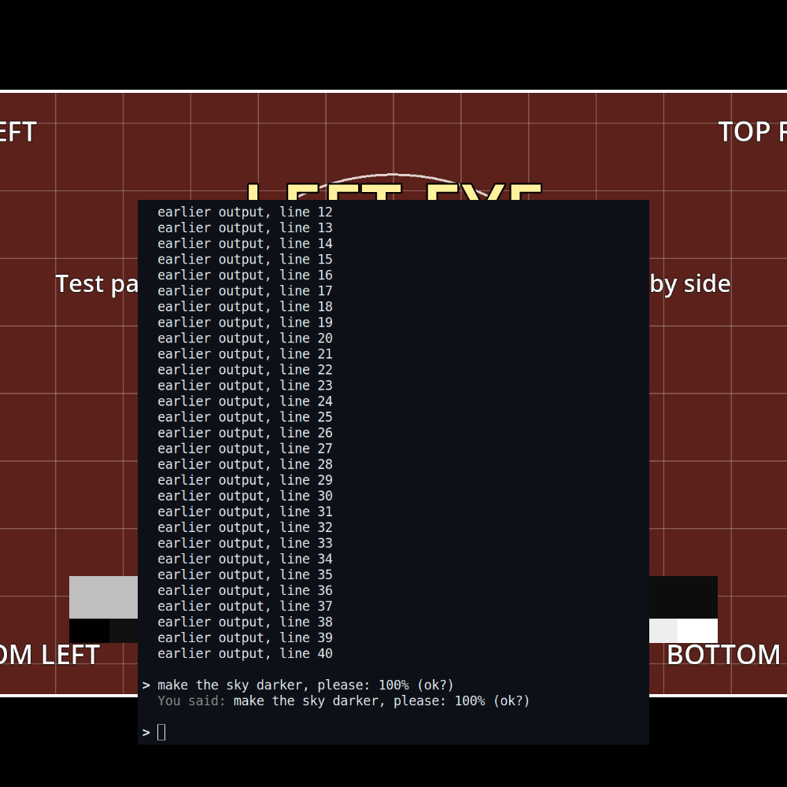
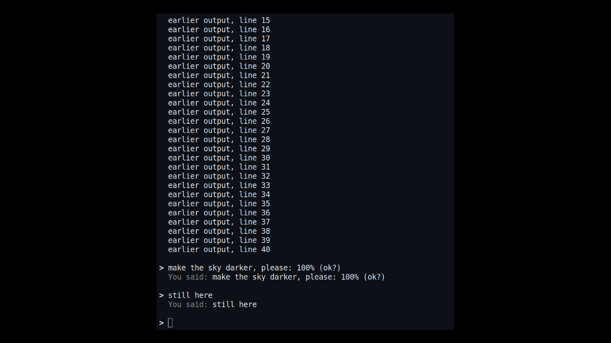

# Assistant

The assistant service lets an AI assistant on another computer on your network work with the player in your headset.
It can see what plays, hear you (push-to-talk) and answer you on a card beside the screen. With your leave, one switch
for each, it can also control playback, change the room around the screen, change your settings, manage files and
the Library, and run Android apps and agents: whatever you can do with the controllers and the menus. Everything runs
on the headset: you install nothing on the PC. An assistant that knows only the headset's address reads the guide
from the headset, pairs, and keeps listening. Decisions D16 and D20 in `docs/decisions.md`.

It is a consumer feature, separate from the dev link (port 47800, `docs/dev/control-protocol.md`), which stays a
developer tool with wide powers and no authentication.

| | Dev link | Assistant service |
|---|---|---|
| Port | 47800, the headset dials the PC | 47801 on the headset (plain HTTP, the guide only), 47802 (HTTPS, the API) |
| Who | developers, `--listener` | anyone, System tab, off by default |
| Authentication | none | a code shown in the headset, then a token and the certificate's pin |
| Commands | everything, code with `--dev-code` | the registry's commands tagged for the assistant, each behind its level's switch; never code, hot reload or scene editing |

## Quick start

1. In the headset: System tab, **Assistant**: turn it on, then press **Let an assistant find me**. The panel shows the
   address, such as `http://192.168.1.20:47801`, and the time left (60 minutes).
2. Tell your assistant (Claude Code, Codex, any agent that can run curl): "The VR video player in my headset is at
   http://192.168.1.20:47801. Read its guide and connect."
3. It reads the guide (`GET /`), asks to pair with its name, and asks you for a code. The headset opens the panel
   at the code ("123 456", large) and shows it on the card too. Read it out.
4. It is paired. It keeps listening; you hold the bumper on the pointer hand and talk, and its answers appear on the
   card under your words.

The guide (`app/assistant/guide.md`, filled in at runtime) is written for an AI reading it cold: what this is, the
state now, pairing, the three ways to keep listening (a background event stream, blocking waits, or MCP), every
endpoint and command, rooms, events and the rules. Its examples work in PowerShell (as `curl.exe`), cmd, Git Bash and
Linux or macOS shells, and it has a Python standard-library snippet.

## In the headset

System tab, section **Assistant**:

| Control | What it does |
|---|---|
| Assistant | On or off (remembered). Off: no node, no port. On: the port opens only while "Let an assistant find me" runs, or once an assistant is paired. |
| Let an assistant find me | Opens pairing for 60 minutes: the guide and pairing need no token. Shows the address and the minutes left, with Stop. |
| (the pairing prompt) | "Claude Code asks to pair with this headset", the code in large digits, Cancel. |
| Paired assistants | Each with its name, the day it paired, and Forget. |
| Let the assistant control playback | Off (the default): it can see what plays and answer on the card. On: play, pause, seek, open, tracks, volume, recentre, seats. |
| Let the assistant change the room | Off (the default): room changes are refused. On: each change shows at once and is kept (a room in the Room tab). |
| Let the assistant change settings | Off (the default). On: your lasting preferences in the Picture, Sound, Subtitles and System tabs, kept as if you set them. |
| Let the assistant manage files | Off (the default). On: copies and downloads into the Library, places, saved hosts. It never sees a share's login. |
| Let the assistant run apps | Off (the default). On: Android apps and the agents on this headset: start, stop, show, hide. |
| Voice goes to | Only when there is more than one place for it: the dev link, the assistant, and each agent running on this headset. |

While an assistant is connected (it follows the events, waits for a message, or asked something in the last minute):

- "Assistant" shows in the panel header.
- The pointer hand's bumper is push-to-talk: hold, speak, let go. The film's sound ducks while you speak.
- The card beside the screen shows the conversation: your words (live while you speak when the headset has speech to
  text, with dancing dots until the final text), and the assistant's answers under them. The newest lines stay.
- A change by the assistant (playback, settings, files, apps) shows in the footer ("Assistant: pause") with Undo
  when it can be undone.
- A room change shows at once, with a note in the footer ("Assistant: add Clock"). Nothing to decide: it is kept.

## The API

`https://<headset>:47802` (the guide, on plain HTTP at `http://<headset>:47801`, explains the self-signed certificate and gives its pin; the headset shows the pin's first 8 characters). Every reply is JSON, `{"ok": true, "result": ...}` or `{"ok": false, "error": "..."}`.
Bodies are JSON or form fields. The full list with parameters is the guide; `GET /openapi.json` is the same as
OpenAPI 3.1.

| Method and path | Token | What it does |
|---|---|---|
| `GET /` | no | The guide (markdown); with a token it also says what plays. Outside the window: "pairing is closed: ask the viewer to press Let an assistant find me". |
| `GET /openapi.json` | no | OpenAPI 3.1 with the room document's schema. |
| `GET /tools/assistant.py`, `/tools/mcp_server.py` | no | The optional clients (below). |
| `POST /pair/start` | no | `client`. Window only, one attempt at a time; returns `pair_id`. |
| `POST /pair` | no | `pair_id`, `code`. Returns `token`, `pin`, `cert_sha256`, `client_id`. |
| `GET /status` | yes | Paired assistants, `allowed` (each switch), `control_allowed`, `room_allowed`, `transcriber`, pairing. |
| `GET /describe` | yes | The commands the assistant may run, the levels with their switches, and the events (below). |
| `GET /state`, `/places`, `/list?path=` | yes | What plays; the file browser's places; a folder. |
| `GET /perf` | yes | The room's measured cost (below, "Performance"). |
| `GET /snapshot.png?from=` | yes | A PNG of what the viewer sees (`width` 640, at most 1280; `height`; `fov`). Rendered on demand (below). |
| `POST /command` | yes | `cmd` and its arguments: any command `GET /describe` lists, while its level is allowed. |
| `POST /card` | yes | `text`, `title`, `seconds`. |
| `POST /answer` | yes | `text`; `heard` and `message_id` fill in a message that had no text. Under the conversation while you spoke in the last 10 minutes. |
| `GET /messages`, `/messages/wait?since=&timeout=` | yes | What you said; the wait holds the connection up to 600 s. |
| `GET /events?types=` | yes | Server-sent events, `Last-Event-ID`, a comment every 15 s. |
| `GET /voice/<id>.wav` | yes | A message's clip (the last 20). |
| `POST /forget` | yes | Forgets the calling assistant. |

Events: `status` (first on every stream), `state`, `file_opened`, `permissions` (any switch turned on or off:
`{control, room, settings, files, apps}`), `commands` (what `/describe` lists changed: `{count}`), `voice_state`,
`viewer_message`, `card_dismissed`, `room`, `pairing`, `browse`, `place`, `download`, `library_copy`.

### Levels and switches

Every command the assistant can run has a level. Two always work; each of the others has its own switch in the System
tab, off by default, kept as `[assistant] allow_*` in `settings.cfg` (`scripts/assistant/assistant_switches.gd`):

| Level | Covers | Switch (`[assistant]` key) |
|---|---|---|
| `read` | what plays, places and folders, chapters, tracks, the room, the measured cost | always |
| `card` | the card beside the screen: how the assistant answers | always |
| `control` | playback: play, pause, seek, open a file, tracks, volume, recentring, seats | Let the assistant control playback (`allow_control`) |
| `room` | the room around the screen; each change shows at once and is kept | Let the assistant change the room (`allow_room`) |
| `settings` | lasting preferences in the Picture, Sound, Subtitles and System tabs | Let the assistant change settings (`allow_settings`) |
| `files` | the Library and files: copies, downloads (`fetch`), places, saved hosts | Let the assistant manage files (`allow_files`) |
| `apps` | Android apps and the agents on the headset: start, stop, show, hide | Let the assistant run apps (`allow_apps`) |

With a switch off, a command of that level is refused before it runs, with 409:
`{"ok": false, "refused": true, "error": "volume: the viewer has not allowed the assistant to control playback
(System, Assistant, \"Let the assistant control playback\")", "switch": "Let the assistant control playback"}`. A
command with no level is refused the same way ("is not available to the assistant"). `/status` has `allowed` with
each switch; the `permissions` event says when one changes. An agent on the headset gets a card at its first start
listing the switches that are off.

### One source: the command registry

There is no list of the assistant's commands written by hand anywhere. The app's command registry
(`scripts/dev/dev_commands.gd`, the one the dev link and the phone remote use) is the only list: a command is open to
the assistant when its spec has `"assistant": "<level>"`, and closed when it has none. `/describe`, the guide's
command and level tables, the OpenAPI's `/command` body and the MCP adapter's tools are all made from it while the
app runs, so a command a feature registers with a tag is everywhere at once, with nothing else to change.

```gdscript
DevCommands.register("subtitle_size", _cmd_subtitle_size, {
	"description": "The subtitles' size, kept as the viewer's preference.",
	"params": [{"name": "size", "type": "float", "required": true, "description": "0.5..2, 1 the default"}],
	"level": "change", "assistant": "settings", "returns": "{size}"})
```

- `level` is the dev link's permission (read, control, change, code); `assistant` is the consumer level above. They are
  separate on purpose: the dev link has its own permission ring.
- A command whose `level` is `code` never carries `assistant`: `register()` drops the tag with an error, so running
  code, hot reload and scene editing stay off this API whatever a feature writes.
- Optional `title` (a short name for a tool list) and `destructive` (true when it deletes, overwrites, or stops an app
  or a session) are hints for the MCP adapter.
- The assistant's own commands (`state`, `tracks`, `subtitle_lines`, `volume`, the room commands, `fetch`,
  `copy_to_library`, `add_place`, ...) are registered by `scripts/assistant/assistant_commands.gd`, like any feature's.
- `assistant_commands.gd` runs every call through `DevCommands.execute` with itself as the gate: the registry checks
  and converts the arguments (refusing unknown ones), then the gate adds the caller's name (`ctx.client`), checks the
  paths `open` and `copy_to_library` may use (local files, test patterns, saved SMB hosts, media servers on the LAN)
  and clips card text. A handler can add `refused`, `errors`, `limit` or `status` to the reply through `ctx.reply`.
- `DevCommands.clashes()` lists any name two scripts registered (the later one wins without a word); a test fails on
  one.
- `describe` itself is the API's own, not a registry command (the dev link has its own `describe`).

`GET /describe` returns:

```json
{"commands": [
   {"name": "volume", "level": "control",
    "description": "The volume: level 0..1, or step (-1..1) from now.",
    "params": [{"name": "level", "type": "float", "default": -1.0, "description": "0..1; -1: use step"},
               {"name": "step", "type": "float", "default": 0.0, "description": "-1..1 from the volume now"}],
    "returns": "{volume}",
    "input_schema": {"type": "object", "additionalProperties": false, "properties": {
        "level": {"type": "number", "default": -1.0, "description": "0..1; -1: use step"},
        "step": {"type": "number", "default": 0.0, "description": "-1..1 from the volume now"}}}},
   ...],
 "levels": {"read": {"what": "...", "switch": null, "allowed": true},
            "control": {"what": "...", "switch": "Let the assistant control playback",
                        "setting": "[assistant] allow_control", "allowed": false}, ...},
 "events": [{"name": "status", "description": "..."}, ...],
 "room_schema": 1, "room_limits": {...}, "supported_widgets": [...]}
```

`params` keep the registry's own form (types string, int, float, bool, array, object, vector3, color, any);
`input_schema` is the same as a JSON Schema object (`DevCommands.params_schema`: vector3 is an array of three
numbers, color an array or a string, any has no type), so a client needs no type mapping of its own. The reply's
objects have their keys sorted; the levels' own order is the table's above. The `commands` event says when the list
changed, a second after the registry last moved (a feature registered, a hot reload re-registered); a change undone
within that second sends nothing.

A `viewer_message` has `text`, `heard_at`, `seconds`, `context` (file, title, position, duration, playing, chapter,
the last subtitle lines) and `block`, the same as plain text ready to read. Speech to text runs on the headset
(`scripts/voice/transcriber.gd`, whisper.cpp behind it, D17). Without it, `text` is null and `audio` links to the clip
so the assistant can transcribe it itself and answer with `heard`.

### Optional clients

The headset serves two Python files (3.8+, standard library), kept in `app/assistant/tools/`:

- `assistant.py`: a command line and a small client (`pair-start`, `pair --save FILE`, `status`, `state`, `send`,
  `card`, `answer`, `wait`, `events`, `voice`, `forget`, `guide`). It checks the pin on every connection.
- `mcp_server.py`: an MCP server over stdio for MCP clients (needs `assistant.py` beside it); resources with update
  notifications; both MCP protocol eras. MCP is the main way the agents on the headset use the player; HTTP stays
  the core every client goes through (D20).
  - Its tools are the service's commands, one per command in `GET /describe`: the description, `input_schema` (or
    one made from `params`), read-only for level `read`, destructive where the command or its description says so.
  - A command added to the app becomes a tool with no change to the adapter.
  - A level the viewer hasn't allowed says "Off now" and names its switch, and a call to it is a tool error naming
    the switch.
  - The adapter follows the event stream: `permissions`, a new stream's `status` or a `commands` event makes it ask
    `/describe` again, and it then sends `notifications/tools/list_changed`.
  - Hand-made tools: `get_status`, `wait_for_viewer_message`, `get_recent_viewer_messages`, `answer_viewer`,
    `look_at_room` (the snapshot as an image).
  - Any base64 field also takes a file on that machine: `model_path`, `texture_path`, `image_path`,
    `base_model_path`, `sky_image_path`, `data_path` (`object_import`'s file).
  - `--config FILE` takes a JSON file from `pair --save` or a curl config such as `.assistant-link`.
  - The tools take the commands' own names (`state`, `card`, `room_apply`); older adapters had `get_state`,
    `show_card`, `change_room`.

Both take `--url`, `--token`, `--pin` or `--config FILE`, or `VRVP_ASSISTANT_URL`, `VRVP_ASSISTANT_TOKEN`,
`VRVP_ASSISTANT_PIN`, `VRVP_ASSISTANT_CONFIG`; prefer `--config`, since a token on a command line shows in a process
list. An agent with a shell needs neither: curl is enough.

## Rooms

With "Let the assistant change the room" on, the assistant can rebuild the room around the screen, add to it or
recolour it. It sends data, never code. Nothing it sends is run, evaluated or loaded as a script on the headset. An
assistant can run any code on its own machine and send only the result (a model, a picture, a document).

### The room document (schema 3)

Rooms are made of objects (`docs/decisions.md` D24). A part is either a **placement** of an object from the object
library (below, "Objects") or a **shape** as an assistant describes it (`type`, `size`, an inline `model`, a
`texture`): both may be sent, and a change keeps every shape as a placement (below, "Kept rooms"). Schema 3 is
schema 2 with placements; schema 2 is schema 1 with objects (a model part's `object`), part addressing
(`"Shelf/Board"` in `recolour`) and library materials (`library_material`). Schemas 1 and 2 are still read; a document
that uses what its schema lacks is refused with "needs schema 2" or "needs schema 3". Kept rooms are written as schema 3.

```json
{"schema": 3,
 "name": "Lounge at dusk",
 "base": "dim_room",
 "light": {"ambient": 0.2, "screen_glow": 0.6},
 "sky": {"color": "#0a1020"},
 "parts": [{"name": "Clock", "type": "cylinder", "size": [0.4, 0.04],
            "position": [1.6, 1.8, -3], "rotation": [90, 0, 0],
            "material": {"color": "#202020"},
            "widget": "clock", "widget_options": {"style": "analog"}},
           {"name": "Shelf", "object": "wall_shelf", "position": [-1.5, 1.2, -3]}],
 "recolour": [{"match": "Wall*", "material": {"color": "#3a5a7a"}}],
 "remove": ["Lamp"]}
```

| Key | What |
|---|---|
| `schema` | 3 (1 and 2 are still read) |
| `name` | what the viewer keeps the room as (letters, digits, space, - and _; up to 40) |
| `base` | `new_room` only: a room id from `room_state`'s `bases` (void, dim room, cinema, the built-in rooms, photo and glTF rooms, recipes) |
| `base_model` | `new_room` only, instead of `base`: a whole room as a `.glb`, base64 (`app/docs/rooms.md` convention) |
| `light` | `ambient` 0..1, `screen_glow` 0..2 |
| `sky` | `{"color"}`, `{"image": base64 PNG/JPEG}`, or `{}` for none; with `stars` {density, twinkle, color} and `clouds` {cover, speed, color} |
| `atmosphere` | `{"fog": {density, height, speed, color}}`: low fog near the floor |
| `seats` | `[{name, position (the floor point), facing}]`, at most 12 |
| `default_seat` | a seat's name: where a viewer opening the room starts (never on an assistant's change) |
| `screen` | `{center, size [w, h], facing, curve 0..1, home}`: the room's own screen, its home placement |
| `parts` | added, or replaced when the name exists |
| `recolour` | the base room's own parts by name pattern (`*`, `?`; case matters); `room_state` lists them. `"<placed>/<part>"`: a part inside a placed model (below, "Objects"); `"material": null` in a change takes an entry out |
| `remove` | `room_apply` only: parts the assistant added |
| `light` | `ambient`, `screen_glow` (the flat look); `key`, `sky`, `screen`, `contact_shadows` (real lighting, below) |
| `lights` | at most 4 point or spot lights: `position` or `attach`, color, energy, range, flicker; no shadows |

A shape: `name`, `type` (`box` size [w, h, d]; `sphere` [diameter]; `cylinder` [diameter, height], round faces up
and down; `plane` [w, d], facing up; `model` with `"model": base64 .glb`, and `"object": "<library id>"` when it was
placed from the object library), `position` [x, y, z] in metres (the room
frame, below), `rotation` [x, y, z] in degrees, `scale` (a number or [x, y, z]), `material` (`color`, `texture`
base64 PNG/JPEG, `self_lit`, `emission`, `emission_strength` 0..10, `roughness` accepted but the rooms are unlit),
`widget` and `widget_options`.

A placement: `name`, `object` (a library id: `object_library` lists them), `position`, `rotation`, `scale`,
`material` (an override, without a picture: `color`, `self_lit`, `emission`, `emission_strength`, `alpha`,
`library_material` and its options, `effect`), `widget`, `widget_options`, `motion`; the object `text` takes `text`
and `text_options`, `particles` takes `particles`. The built-in primitives are 1 m (`box` a 1 m cube, `sphere` 1 m
across, `cylinder` 1 m across and 1 m tall, `plane` 1 x 1 m facing up): their placement's `scale` is their size in
metres (box [w, h, d], sphere s, cylinder [d, h, d], plane [w, 1, d]). `text` at scale 1 is a line 0.1 m high, so its
scale is the line height over 0.1; `particles` is an area 1 m a side. Any other object is a model from the library.
`RoomSchema.build_form()` turns a placement into the shape the room is built from.

**Kept rooms: placements only** (`scripts/assistant/room_keep.gd`). When a change is applied (`room_editor.apply`,
new and patch), each shape becomes a placement before the room is built:

| Sent | Kept as |
|---|---|
| a `box`, `sphere`, `cylinder` or `plane` without a picture | a placement of that built-in, its size (times its scale) as the scale, its material as the placement's |
| a `text`, a `particles` area | a placement of the generator, its words or area kept on it |
| a `model` (base64 `.glb`) | a user object named after the part (`ObjectLibrary.import_glb`); the same bytes are the same object (the md5 its manifest keeps), not a copy; a model naming a library `object` the library has: that object |
| a shape or model with a `texture` (a poster, a photo, a sign), or a placement sent with one (`recolour` with `texture`) | a **picture object**: a user object, the shape's mesh at its size (a box with its `uv` layout) with the picture as its unlit material, written as a `.glb` (`RoomModel.with_picture`: the picture's own bytes in the file's buffer), named after the part, tags `["picture"]`, `mount` `wall` for a plane (its face turned to +Z, the placement turned back) or a box under 5 cm deep, else `free`; the placement keeps the rest of the material (`self_lit`, emission, alpha, an effect) |

The reply's `kept_objects` lists them (`{part, id, name, new}`) and its summary names the new ones ("kept Poster in
the object library"): each can be placed in any room by its id. A change that is refused after its parts were kept
(the cost cap, a seat outside the walls) takes the objects it made out of the library again. User objects go under
`user://objects/<id>/`, never under `res://`: nothing a viewer or an assistant gave ships with the app. A picture
object shows its picture as a part's picture does (`assistant_room.gd _model_surfaces`: self-lit and white in a flat
room, a cut-out where it is transparent, `color` on the placement tints it, a library material replaces it), and costs
what the shape did (one mesh: `COSTS.part`). A wall or ceiling object gets no contact shadow.

**Migration.** A kept room of schema 1 or 2 (`user://recipes`) is converted when it is loaded
(`assistant_room.gd load_saved`): its `model_file` and `texture_file` parts go into the library the same way, and the
room is saved back as schema 3 once. One that can't be converted (a model that doesn't read) is built as it was, with
the reason in the log, and left as it was. The showrooms (`res://environments/showrooms`) stay schema-2 documents
shipped read-only (`tools/showrooms.gd`); only a viewer's kept room fills the viewer's library.

**Materials.** What a surface shows is `color x texture x light + emission x emission_strength`
(`shaders/env_unlit_tex.gdshader`, `assistant_room.gd material()`). `light` is the room's light, as on its own walls
(the ambient level and the screen's spill), or 1 when `self_lit`. A textured part is `self_lit` by default and its
`color` defaults to white, so a photo or a poster shows as the picture whatever the room's light; `"self_lit": false`
makes it darken with the room like paint. Without a texture `color` defaults to grey, follows the room's light, and
`emission` makes it glow. Emission on a picture is added on top and washes it out: the reply warns about it (seen
live: a poster with white emission showed nearly white).

**The room frame.** Every position in a room document and in `room_state` is in the room node's own frame: metres,
the floor at y = 0, the room's own seat at the origin facing -Z. `room_state` gives `frame` (this, in a sentence),
`screen` (`center`, `size`, `facing`: the way the picture faces; `spherical`; and `relative_to_eye`: the distance,
height above the eyes and yaw the panel uses) and `viewer` (`seat`: the floor point the viewer sits over, which moves
with seat choice; `seated_eye_height`, 1.2 m, what rooms are designed for; `eye`: the measured eyes; `head` and
`head_facing`: the head now). Before, `room_state` gave the screen only as distance and height from the eyes, which
read as nonsense against the parts' frame (a passthrough room: distance 0.89, height -0.15).

**Pictures on shapes.** The guide says exactly how each part type maps a picture (measured from the engine's meshes
in `test_assistant_room.gd`). A box by default (`"uv": "atlas"`) cuts one picture into six pieces, BoxMesh's 3 x 2
layout; `"uv": "front_only"` puts the whole picture on the front (+Z) face and `color` on the other five (a canvas);
`"uv": "each_face"` puts the whole picture on every face (`assistant_room.gd box_mesh()`: BoxMesh's arrays with each
face's piece stretched to the whole picture).

**Text.** `"type": "text"`: `text` (at most 1000 characters), `size` [line height in metres, default 0.1],
`text_options` (`color`, `background`, `weight` regular or bold, `align`, `max_width` in metres to wrap). A Label3D
in the panel's font (Inter) as a multichannel signed distance field, so it stays sharp at any distance; bold is a
FontVariation; the background is a quad behind it. At most 16 text parts. `add_text` is the shortcut. A text is kept
as a placement of the library's `text` object (its line height over 0.1 as the scale), and `object_place {id:
"text", text}` puts one in the room.

**Bounds and warnings** (`room_bounds.gd`). `room_state` gives the base room's `interior` (a box in the room frame,
measured with six rays from the seated eyes to the farthest surface each way, sides with nothing `open`; unknown in
the passthrough room), cached per base and listed under `bases` once a base has been on show, and each stock part's
`aabb`. A change's reply lists `warnings` for each part (boxes only, cheap): `outside_room`, `inside_stock_part`,
`behind_stock_part` (the line from the eyes to its centre crosses one), `behind_viewer`, `behind_screen`, `too_small`
(under 0.5 degrees across from the eyes) and `emission_on_picture`.

**Effects: named, bounded, drawn by the app.** The assistant never sends code for how something looks or moves; it
names an effect the app owns and gives it numbers within bounds, as with widgets. Every effect declares a cost
(`room_schema.gd COSTS`), and the room's total is capped (`limits.cost`, 120) so the headset keeps 72 frames a second
under the film; the cap is a ceiling, not a target.

- **Transparency.** A picture's alpha is respected: transparent pixels make a cut-out by default (alpha-tested,
  edges smoothed by MSAA's alpha to coverage), `"alpha": "blend"` makes it see-through (cost +1), a colour with
  alpha below 1 blends by default. `env_unlit_tex.gdshader`, compiled with `ALPHA_CUT` or `ALPHA_BLEND` defined.
- **Motion** (`room_motion.gd`): spin, bob, sway, orbit, flap and a one-shot `move_to` (optionally on the film's
  clock: `"at": "end-30"`, so seeking undoes it). One `_process` loop per room; every cycle a sine; each part a
  phase and +-4 % speed offset from its name, so copies drift apart; `sync` puts parts in step (a pair of wings).
  Bounds keep it comfortable (spin at most 180 degrees a second, bob at most 1 m, sway at most 60 degrees).
- **Particles** (`room_particles.gd`): snow, rain, leaves, embers, fireflies, dust in an area box. GPUParticles3D
  (noise turbulence; the CPU kind has none), soft mipmapped sprites made at load (embers and fireflies an additive
  bright core in a wide faint halo, dust faint out-of-focus discs), size and alpha over life, varied
  per particle, prewarmed. Caps: 6 emitters, 600 particles each, 2000 a room. No depth fade (on the Mobile
  renderer it needs a depth copy every frame).
- **Material effects** (`shaders/room_effect.gdshader`, compiled once per effect with `FX_<NAME>` defined;
  `room_outline.gdshader` for toon_outline's second pass): rim_glow (fresnel), hologram (additive, scanlines faded
  to their average where too fine for the pixels), glass (fresnel reflection of a fake surroundings and the screen),
  metal (a procedural studio surroundings: dim floor, bright horizon band, sky, tinted by the room's light; a
  broad and a sharp highlight), toon_outline (three cel tones from a fixed key light; the outline pushed out in
  pixels, so it stays 2 px near and far), dissolve (two octaves of value noise, alpha-tested), pulse and flicker (a light inside,
  brighter facing you). Each part gets a seed from its name, so copies are out of phase.
- **The effect library** (`docs/effects.md`): those eight and 40 more, connected. `RoomSchema.EFFECTS` is
  `EffectLibrary.schema_effects(false)` (the sky's: `SKY_EFFECTS`), a part's `material.effect` is checked by
  `EffectLibrary.validate` (a sky id is refused there, with a pointer to `sky.effect`) and costs its
  `cost_units` x `COSTS.effect` (the first eight as before); `assistant_room.gd _effect` calls `EffectLibrary.apply`
  and gives a reactive effect's film path to the room's `RoomReact` (meta `react`). `"sky": {"effect": {...}}` puts a
  sky effect on the sky sphere (validated and costed alike). A layered look, a library material under an effect
  whose `layers` is true, uses `EffectLibrary.apply_layered` with the material's albedo map, its colour or tint and
  its tiling, mapped on the part's own axes (by UV on spheres and cylinders, and for the first eight); an effect that
  draws its own surface over a library material is refused. wipe's and scan_in's `size` and wind_sway's `base` and
  `height` come from the part's own extent when the document leaves them out (`fit_effect`). `room_state` names each
  surface's `effect` (`stock_parts[].effect`, `objects[].parts[].effect`). See-through effects (blend alpha or add)
  cast no shadow.
- **Photosensitivity ceiling**, for every effect and widget: brightness changes no faster than 3 Hz and swings by at
  most 0.4 of the surface's own brightness (`RoomSchema.MAX_HZ`, `MAX_SWING`). The schema refuses more, naming the
  ceiling; the shaders clamp again. Candle flicker is four sines at the rate and below it (1, 0.71, 0.43, 0.23 times,
  weights summing to 1), so it wanders and never strobes; a test reads a clip of it and checks no frame-to-frame step
  is larger than a quarter of its brightness. screen_glow follows the film through the bias light, low-passed with a
  0.25 s time constant (cut-off 0.64 Hz). Particles: fireflies glow twice a life (under 1 Hz), embers fade.
- **Screen-reactive glows** (`shaders/room_glow.gdshader`, `scripts/assistant/room_react.gd`): screen_glow with
  `react` brightness or loudness, `style` shimmer (the ridges of two octaves of drifting value noise, like caustics)
  or ripple (rings from the part's centre at 0.8 Hz), `amount` at most 0.4. Brightness is read on the GPU from the
  bias light's 4 x 2 copy of the picture; a room that uses it asks the bias light to keep sampling
  (`request_sampling`) even when the bias light itself is off (its tint stays off). Loudness is the Master bus's peak
  level (`AudioServer.get_bus_peak_volume_*_db`: no analyser on the bus), scaled by a 3 s average so quiet films
  react too, through two 0.1 s low-pass stages and a slew limit of pi x 3 a second (no steeper than a full-range
  sine at 3 Hz); a test feeds it a 10 Hz beat (moves it under 0.1) and a loud scene after a quiet one (comes
  through). One `React` node per room, only if a glow reacts.
- **Sky and atmosphere** (`shaders/room_sky.gdshader`, `shaders/room_fog.gdshader`): the sky sphere draws stars
  (one candidate per cell of a 3D grid on the direction, about 0.45 degrees, kept by density; at least a pixel wide
  by `fwidth`, their energy spread when smaller, so they neither alias nor crawl; each its own twinkle rate 0.15 to
  1.2 Hz, swing at most 0.4) and clouds (four octaves of value noise on a plane overhead, drifting, thinning to the
  horizon), with a fixed sub-level dither against banding. Fog is `FOG_LAYERS` (5) thin blended layers up to its
  height, denser low down, cut from one noise field (the layer's height its third axis) so the wisps stack into
  soft volumes; faded where the eye looks along a layer. Once the base's walls are measured (`RoomBounds.interior`)
  the layers are fitted to the floor and end 0.15 m short of the walls, fading out over the last metre, so no line
  shows on a wall; in an open room they fade radially within 5 m. No depth texture (a copy every frame on Mobile).
  Costs: stars 1, clouds 2, fog 0.6 a layer.
- **Seats and the screen** (`seats`, `default_seat`, `screen`): AssistantRoom gives seat choice
  (`scripts/comfort/seat_choice.gd`) its seats, names and facings, and sets its screen anchor and width from the
  room's screen. A seat moves the tracking origin there and turns the room to the seat's facing (the eye height stays
  the viewer's own); the change is a fade to black and back (0.18 + 0.25 s), never a slide. The default seat applies
  only when the viewer opens the room (a room built by an assistant's change carries meta `assistant_apply`, and the
  viewer keeps their seat by name and the screen where they had it). If that change moved, renamed or removed the
  viewer's seat, the room keeps its place round them (seat_choice `moved`, `moved_name`; the Room tab says "Front
  row (moved)" with a button that fades them to its new place; `room_state` and the change's reply say so). A new or
  changed `screen` is shown at its home (`home_screen()`: width, curve, place from the seat in use) only while the
  screen is where the room last put it (`screen_at_home()`; a viewer's recentre keeps it); Reset room keeps such a room, goes to its default seat
  and puts the screen home. A room's own screen stays fixed and faces its own `facing` from every seat
  (`main.screen_turn`, the yaw of its normal, set by seat_choice while the screen is at home; NAN, the old "faces
  the viewer", for other rooms and after the viewer's recentre). Refusals (`RoomSchema.layout_errors`,
  `room_editor.seats_outside`): a seat more than 45 degrees off the screen's axis, the screen's angular
  width 12..100 degrees and height up to 75 from every seat's eyes (the floor point + 1.2 m), seats in front of it and
  at least 1 m away, seats 0.2 m inside the walls (the base's interior, measured on the base when not cached).
  Warnings run per seat. `suggest_seat` puts a card with two buttons ("Move there", "Stay here"; `watch_card.gd`
  actions, the trigger on one dismisses the card with its id); the viewer's answer is `card_dismissed`.

`room_apply` changes the room on show; `new_room` replaces it. The shortcuts make a document: `add_shape`,
`add_text`, `add_model`, `recolour` (the assistant's parts and the base's own; a text part's colour), `set_lighting`,
`remove`.

The headset checks the whole document and returns every problem with its JSON path:

```json
{"ok": false, "error": "the room document has 2 problems",
 "errors": [{"path": "$.parts[1].size", "error": "3 numbers (width, height, depth)"},
            {"path": "$.parts[2].widget", "error": "unknown widget weather; supported: clock, film_progress, ..."}]}
```

### Widgets

A part can carry a behaviour the app provides: `"widget": "clock"`. The assistant sends the name and options; the app
draws it on the part's front (a box's +Z face, a cylinder's cap, a sphere's front, a plane's top, a model's front).
A widget redraws only when what it shows changes, at most once a second (`film_progress` ten times a second). Its
canvas is 256 pixels high.

| Widget | Shows | Options |
|---|---|---|
| `clock` | the time of day | `style` analog or digital, `hours_24`, `color`, `background` |
| `film_progress` | how far the film is | `style` bar or ring, `color`, `background` |
| `now_playing` | the title | `color`, `background` |
| `end_time` | "ends 23:20" | `color`, `background` |
| `battery` | the headset's battery and the controllers' | `controllers`, `color`, `background` |
| `screen_glow` | the part glows in the picture's colour (the bias light's colour; white when it is off) | `strength` 0..2, `react` none/brightness/loudness, `style` shimmer/ripple, `amount` 0..0.4 |

`room_state` lists them with their options (`supported_widgets`), and so do the guide and the OpenAPI. An unknown
widget is refused with the list.

### Models

A model is a binary glTF (`.glb`) with everything embedded. Before the engine reads it, the headset checks it: only
material and geometry extensions (a behaviour graph such as `KHR_interactivity`, audio or vendor extensions are
refused); no outside files (a `uri` that is not `data:`); no script, code or eval keys in its `extras`. The engine
reads it with GLTFDocument on a worker thread (the frame never waits). After reading: animation players, cameras,
lights and audio players are removed, and the materials become the rooms' unlit ones.

A model's **parts** are its mesh nodes (`room_model.gd`): each named by its glTF node name, else its mesh's name, else
`part_1`, `part_2`, ... in the file's node order; made plain (letters, digits, space, - and _; anything else `_`) and
unique (`Board`, `Board_2`). The name stays on the MeshInstance3D (meta `object_part`), so it is stable however the
model was made.

### Objects (the object library)

"However objects were created, the app must be able to identify their parts and do whatever with them." The object
library (`scripts/assistant/object_library.gd`) keeps things to put in a room: each a `.glb` and a small manifest.
Rooms are made of objects (above, "Kept rooms"): every part of a kept room is a placement of one, and the library is
the one source of a room's models and pictures.

| Where | What |
|---|---|
| Built in (`object_builtins.gd`) | Made in the app from primitive meshes, so the repository holds no model files and nothing anyone else made: Picture frame (Frame, Mount, Picture: a quad that takes a picture whole), Wall shelf (Board, Brackets), Pot plant (Pot, Soil, Leaves), Wall clock (Rim, Face, with the `clock` widget drawing the hands). Written as a `.glb` once a session and read back like any import. |
| Built-in primitives | `box`, `sphere`, `cylinder`, `plane`: 1 m, centred, one grey part named after the shape (`Box`, ...: `"<placed>/Box"` in a recolour). A placement's scale is their size. The room builds them at that size from the same primitive meshes (a box with a picture's `uv` layout is a picture object instead), so a widget's face is not stretched. |
| Built-in generators | `text` and `particles`: a manifest (`generator`), no `.glb`; their node is made per placement from its `text` and `text_options` (`assistant_room.gd _text()`) or its `particles`. The Objects tab doesn't list them (they need those options). |
| The viewer's (`user://objects/<id>/`) | `object.glb`, `manifest.json`, `thumb.png`. Never under `res://`: an imported object may hold anything the viewer gave, logos too, so it stays in the user's data. A deleted one waits in `user://objects/.deleted/` until its undo is dropped. Imported, or kept from a room's part (a model, a picture object). |

A manifest: `{id, name, tags, source (builtin or user), mount (wall, floor, table, ceiling or free), size [w, h, d],
bounds {min, max}, triangles, parts: [{name, color, texture, triangles}], widget?, widget_options?, md5 (a user
object's .glb, so the same bytes are kept once), picture? (a picture object), primitive? or generator?}`. The catalogue is
the built-ins and the folder as it is on disk, so it survives restarts. Thumbnails are drawn in the app without the GPU
(`object_thumb.gd`: the triangles from the front, a little from above and the right, in the parts' colours, shaded,
on a clear background), on a worker thread: they never wait for a frame or stall the headset.

**Importing.** A `.glb` is taken as it is, checked like any room model (no scripts, no outside files, only material
and geometry extensions) and against the limits (`model_triangles`, `model_parts`, `texture_size`). An **SVG** is made
solid in the app (`svg_extrude.gd`, GDScript, no outside tools):

- Path data `M L H V C S Q T A Z` (absolute and relative, implicit repeats, arc flags without separators), `rect`
  (rounded too), `circle`, `ellipse`, `polygon`, `polyline`; transforms on paths and groups; the root's `viewBox`;
  fills from attributes, a `<style>` block's `.class` and `#id` rules and `style=""`; `fill-rule` nonzero and evenodd.
- Curves flattened to within 0.4 mm at the model's size. A shape's outlines are sorted by its fill rule into outer
  edges and holes (a sample just inside and just outside each outline's longest edge), its faces cut into pieces
  without holes (a vertical cut through each hole, the engine's polygon clipping) and triangulated (Geometry2D), then
  extruded to `depth` (2 cm) with a chamfer of `bevel` (by default the smaller of 8 % of the depth and 0.2 % of the
  width; none where it would turn an outline inside out). UVs: front and back planar over the whole drawing (a picture
  lies on the front as on the drawing), the sides wrapped round each outline. Later shapes stand a hair forward, so
  overlapping colours never fight. The front faces +Z, the back is at z = 0.
- Each top-level element (a path, or a group with all in it) is a part: its `id`, else `part_1`, ...; a drawing whose
  top level is one group (an editor's layer) has its parts one level down. `part_names` renames them in order;
  elements given one name are joined into one part.
- Clip paths and masks are ignored; gradients and patterns become one flat colour (the first stop); strokes, text,
  `<use>` and pictures are left out. Each with a warning in the reply. An outline that crosses itself can't be filled
  and is left out (said too).

**Placing.** `object_place {id}` adds a placement, `{"name", "object": "<id>", "position", "rotation", "scale"}`: the
room keeps only the id, and its model comes from the library when the room is built (read once a session; two copies
of one object are one mesh in the headset). `object_place {id: "text", text, text_options}` places words (`scale` 1:
a line 0.1 m high); particles are sent as a part with `room_apply`. Where: `at` `wall` (the
wall the viewer looks at: the head's level direction against the room's interior box, `RoomBounds.interior`), `floor`
(1.3 m ahead of the head, on the floor), `ceiling`, `front` (1.5 m ahead at eye height); or `position` and `rotation`.
A wall object's back goes on the wall, its front out (`turn` spins it about the wall's normal); a floor or table
object's bottom on the floor, facing the viewer (`turn` about up); a ceiling object's top on the ceiling. Without
`at` or `position`, its mount decides. A stock room becomes a kept room of its own, "<room> with objects". Every object
change (`object_place`, `object_move`, `object_import`, `object_delete`, and the Objects tab's) has a summary and an undo:
the room as it was (a kept room built again from its document, a stock room shown again), the import deleted, the
deleted object back.

**Part addressing.** A part inside a placed object is `"<placed name>/<part name>"`, a pattern on each side:

| `match` | Reaches |
|---|---|
| `Wall shelf` | the whole placed object, as before (and its part-level colours go) |
| `Wall shelf/Board` | the board of that shelf only |
| `Wall shelf*/B*` | every part starting with B of every shelf |
| `Chair/part_1` | the first unnamed mesh of an imported model placed as Chair |

A part-level entry is a `recolour` entry of the document; `material`'s fields go on top of what the part showed (the
whole object's material when it has one, else the part's own colour), so an `emission` alone keeps the colour, a
`texture` replaces it, and a later entry wins where two set the same field. `reset: true` (the command) or
`"material": null` (a document change) takes entries out: the part's own colours again. Removing a placed object takes
its part-level entries with it. They are saved in the kept room's document and built again when it loads
(`assistant_room.gd _recolour_parts`); parts that end up alike share one material. A part-level match that reaches
nothing is kept with a `no_such_part` warning; the `recolour` command refuses it.

**Library materials.** A material object may name `"library_material": "<id>"` (the `recolour` command's
`material`): a textured surface from the material library (`docs/materials.md`: 42 CC0 sets of wood floors, carpet,
velvet, leather, plaster, brick, marble, metal...). The `materials` command lists the ids (`tag`: floor, wall, fabric,
wood, leather, metal, stone, ...). With it a material object takes:

| Key | What |
|---|---|
| `color` | the colour it shows on average, its pattern kept (the library's `colour` option) |
| `tint` | `#rrggbb`, multiplies its colours (after `color`) |
| `tiling` | metres per repeat of its pattern, 0.02..20 (default: the material's own, `materials` lists it) |
| `triplanar` | `true`: three blended projections, for curved models without usable UVs; three times the texture reads |
| `emission`, `emission_strength` | added on top, as on any material |

It can't go with `texture` in one material object, and goes under an `effect` only when that effect layers (a
layered look, above); `tint`, `tiling` and `triplanar` need it (except in a
part-level entry, which may tint its object's library material). A part, a whole placed object, one part of it
(`"Sofa/Seat"`) and a base room surface `recolour` reaches can all take one. A box, a plane and a model take the
pattern on their own axes in metres (the instance's scale included); a sphere and a cylinder on their UVs, repeated so
the pattern keeps its size (whole repeats round them). Every surface with the same material and options shares one
`ShaderMaterial` and its textures (`assistant_room.gd library_surface()` -> `MaterialLibrary.get_material()`); in a
room with real lighting it is the lit form (below, "Lighting"). An id the headset doesn't know is left out with an
`unknown_material` warning, and the rest of the material applies.

Changing it with `recolour`: `material` names one, which shows as itself (the old colour, tint, tiling, picture and
an effect that doesn't layer go; an emission stays) unless `color` comes with it. On a part that has one, `color`, `tint`, `tiling` and
`emission` change it; `texture` replaces it; `reset` takes it away. The same holds for a part-level or a base surface's
entry that has one (`RoomSchema.merge_material()`, `ObjectCommands.entry_material()`); other entries are replaced as
before. For example `recolour {match: "Sofa/Seat", material: "velvet", color: "#5a1830", tiling: 0.25}` keeps
`{"match": "Sofa/Seat", "material": {"library_material": "velvet", "color": "#5a1830", "tiling": 0.25}}` in the room
document. `room_state` reports what a surface shows: `stock_parts[].material` and `objects[].parts[].material` (the
id, "" for none) with `color` its mean colour (the swatch times the tint). A library material costs
`COSTS.library_material` (0.5), triplanar `library_triplanar` (1.0) more.

**Commands** (`object_commands.gd`, registered by `command_host.gd` for every client):

| Command | Level | What |
|---|---|---|
| `object_library {tag, source}` | read | the catalogue: id, name, tags, source, mount, size, parts |
| `object_info {id}` or `{placed}` | read | a library object's manifest, or a placed one's parts as they show and which entry sets each |
| `object_import {name, data, format, tags, mount, width, depth, bevel, part_names}` | room | a `.glb` or an SVG into the library; `path` instead of `data` is the dev link's only |
| `object_place {id, name, at, position, rotation, turn, scale}` | room | into the room |
| `object_move {name, at, position, rotation, turn, scale}` | room | what is left out stays |
| `object_delete {id}` | room | a user object out of the library (destructive; built-ins can't go); refused while a kept room places it, the reply naming the rooms (`rooms`): remove it from them first. The Objects tab's Delete says the same |
| `object_put_back {name}`, `object_tidy_up` | room | object physics (`docs/physics.md`): one object, or every one, picked up, dropped or thrown, back where it was placed (its `home`) |
| `object_attach {name, to, offset, rotation}` | room | a text or particles area follows an object (`attach`, `offset` in the room document); empty `to` detaches it where it is |
| `object_throw {name, velocity, spin}` | room | drops or throws an object as a hand would; it rests where it lands and is kept there |
| `object_physics` | read | what can be picked up, what moves, what moved, the cost |
| `recolour {match, color, emission, emission_strength, texture, material, tint, tiling, triplanar, reset}` | room | a part as `"<placed>/<part>"`; `material` a library material's id (`materials` lists them) |
| `remove {name}` | room | a placed object out of the room |

`room_state` has `objects`: every placement (in a kept room every part) with its `object` id, the object's name
(`object_name`), where it is and its parts (none for a text or a particles area); `placements` names the built-in
primitives and generators. A whole placement's `recolour` sets the placement's `material` (on a picture object the
picture stays: `color` tints it); `"<placed>/<part>"` reaches a part of any placement, a primitive's one part
included. The MCP adapter takes `data_path` for `data`.

**Performance.** Placed copies of one object share its meshes (the room editor reads a model once per session by its
data, and each copy is a duplicate of that); parts painted alike share one material. A model's parts are capped
(`model_parts`, 128) and cost a draw call each past the first (`COSTS.model_part`, 0.2), a part-level recolour a
material (`part_recolour`, 0.05), the room's recolour entries are capped (`recolours`, 256), and triangles count as
for any model. The measured guard (`RoomPerf`) applies after each change as before.

### Objects from Fab

A scanned asset downloaded from the Fab store (`scripts/assistant/fab_import.gd`): the viewer downloads it themselves,
on the headset (the in-app browser or the desktop one; the site gives the zip without signing in), under their own
Fab licence. That licence lets them use it, not hand it on (no standalone redistribution, free or not), so no Fab
asset is ever in this repository or the release, and an import is a user object like any other (`user://objects`).

- The Objects tab lists the Fab zips in the Downloads folder whose asset isn't in the library yet, under **In
  Downloads, from Fab**: **Add <name>** imports one, on the main thread behind a notice (as a first lightmap bake:
  the headset shows its waiting view for the second it takes, not a broken-up picture).
- The zip: the asset's `.json` at its top (`id`, `name`, `tags`, `meta` with `small3dasset`), an `.fbx` or `.glb`, the
  maps as `<name>_<id>_<res>_<Map>.jpg`. The model is read with the engine's FBX loader (the `fbx` module, in the
  player build); the material is made from the maps, not the `.fbx`'s (which names the full asset's 4K files): the
  colour with the ambient occlusion multiplied in (rooms draw objects unlit, so the crevices keep their shade), the
  normal map and roughness (or gloss turned round) kept in the `.glb` for lit rooms, an opacity map as the colour's
  alpha, cut out. Maps over 2048 px are made smaller; the `.glb`'s maps are JPEG.
- Small3dAsset puts it on a table, else the floor. The manifest keeps the asset's id as `fab`, so a download is added
  once. Use the Low or Medium download: the object limits (150,000 triangles) refuse the full scan.

**In the app, with no browser** (`scripts/assistant/fab_store.gd`, `ui/fab_panel.gd`; `docs/features.md` "Fab in the
app"; D27). The app itself searches Fab for Quixel Megascans' free 3D models and downloads the chosen one's FBX zip
(mid, else low, else high) into the same import. An assistant asks the app with the commands below; the app makes
every request, one at a time, at least 1 s apart, and backs off when Fab says it is busy.

**The licence comes first, and only the user can accept it.** Until the user has accepted Fab's licence (its EULA)
in the headset's menu, in **Objects → Your objects → Fab**, every Fab command but `fab_status` refuses with
`{"ok": false, "error": "eula", "message": "Ask the user to accept Fab's licence in Objects → Your objects → Fab
first. ..."}`. No command can accept it. Ask the user to open that card, read the summary (or the full licence), and
press **Accept**; `fab_status` then says `eula_accepted: true`. The user can withdraw it in the same place, and the
commands refuse again.

| Command | Level | What |
|---|---|---|
| `fab_status` | read | `{eula_accepted, eula_date, where, message (until accepted), backoff_s, busy, job}`; `job` is the import under way or the last one: `{uid, title, state, file, quality, bytes, total, error, message, object: {id, name}}` with `state` files, link, download, import (under way), then done, already, failed or cancelled |
| `fab_search {query, cursor}` | read | 24 results a page: `{query, results: [{uid, title, category, tags, importable, in_library}], count, next, cached}`. `next` is the next page's cursor (empty on the last page); give it as `cursor` for that page. `in_library` is the object's id when it is in the library already. Titles are English, as Fab gives them; search in English |
| `fab_import {uid}` | room | starts the import in the background: `{state: started, uid, title}`; poll `fab_status` until `job.state` is done (then `object_place {id: job.object.id}`), already, failed or cancelled. In the library already: `{state: already, object: {id, name}}`, at once and with no download |
| `fab_cancel` | room | stops the import under way: `{cancelled}` |

Errors, beside `ok: false`: `error` is a code and `message` says it in English. `eula` (above); `backoff` (Fab asked
the app to wait: `wait` seconds, `http` 429 or 5xx; nothing is sent until then, so don't retry sooner); `network`,
`http`, `shape` (Fab's answer was not as expected: its site may have changed); `busy` (one import at a time);
`no_file` (no FBX zip: not importable); `too_big`; `uid`; `query`; and `import` (the importer's own reason). From
the dev link the error is one string, `"<code>: <message>"`.

A search page is kept a day, so the same search again costs Fab nothing; there is no way to list the whole catalogue,
on purpose. Ask for the next page only when the user wants more.

### Pictures

Pictures the user keeps while browsing (`scripts/pictures/`; `docs/features.md` "Pictures"; D29), to put in the room
as an object or on a part. The app never browses for the user: `pictures_search` only opens the search page, and the
user keeps what they choose (the right stick click on an image, Copy image, or saving to Downloads). Titles are the
user's content; source addresses stay on the headset and are never in an answer.

| Command | Level | What |
|---|---|---|
| `pictures_search {query}` | control | opens Google Images for the words in the browser on the big screen: `{opened, note}`. Nothing more: tell the user how to keep one |
| `pictures` | read | `{pictures: [{id, title, aspect, width, height, alpha, date, objects: [{id, as}]}], count, as}`, newest first |
| `picture_place {picture, as, name, where, position, rotation, turn, scale}` | room | `as`: `poster`, `framed`, `canvas` or `cutout`. The object is made at the picture's shape (once for each kind) and placed as `object_place` places (`where` empty: a wall one on the wall the user looks at, a cut-out on the floor before them). A wall one stays on its wall until the user pulls it off. `{state: kept, placed, name, ...}` |
| `picture_apply {part, picture}` | room | the picture on one part (`pointed_part`'s part, a room surface's name or `"<placed>/<part>"`), kept like a recolour, with an undo |
| `picture_delete {picture}` | room, destructive | deletes the picture and the objects made from it: `{deleted}`. Refused while a kept room places one of them: `{error, rooms}` |

### Surfaces

Materials imported on the headset from Quixel Megascans (through Fab, behind the same licence as "Objects from
Fab"), Poly Haven and ambientCG (`scripts/env/surface_store.gd`, `surface_import.gd`; `docs/features.md`
"Surfaces"; `docs/materials.md` "User materials"). The app makes every request, one at a time for each site, at least
1 s apart, and backs off when a site says it is busy. Search in English.

| Command | Level | What |
|---|---|---|
| `material_search {query, source, cursor}` | read | `source`: `megascans`, `polyhaven`, `ambientcg`, or empty for all three. `{query, results: [{source, id, title, tags, tiling (metres, 0 unknown), importable, in_library}], next, credits, errors}`. A source that refuses (Fab's licence not accepted, a site busy) is in `errors`, and the others still answer. `next` is the cursor for the next page. Show the `credits` line where you show the results |
| `material_import {source, id}` | room | starts the import in the background: `{state: started, source, id, title}`, or `{state: already, material: {id, name}}`. Megascans before the user accepts Fab's licence: `error: "eula"` |
| `material_status` | read | `{job, busy, backoff_s {polyhaven, ambientcg, megascans}, fab_eula_accepted, user_materials, disk_bytes, gpu_bytes_if_all_loaded, gpu_bytes_loaded, astc, resolution}`; poll it after `material_import` until `job.state` is done, already, failed or cancelled |
| `materials {tag}` | read | the library, the user's materials too (`source`: the site, else `bundled`; `user`) |
| `material_apply {part, material, tiling, turn, tint}` | room | a library material on one part: a room surface by name or `"<placed>/<part>"`. `tiling` metres a repeat (0: the material's own), `turn` degrees, `tint` `#rrggbb`. Kept like a recolour, with an undo |
| `pointed_part` | read | what the user's laser is on: `{part, kind: room \| object, placed, name, material, picture, distance, point}`, or `{part: "", message}`. "Make this wall brick": `pointed_part`, then `material_apply` with its `part` |
| `part_reset {part}` | room | the part as the room built it: the material, picture or colour given to it goes |

Errors, beside `ok: false`: `error` is a code and `message` says it in English: `eula`, `backoff` (`wait` seconds,
`http`; don't retry sooner), `network`, `http`, `shape` (the site's answer was not as expected), `busy` (one import at
a time), `no_file`, `too_big`, `query`, `source`, `cursor`, `id`, `import`.

### Lighting

A room is flat (unlit shaders, `env_unlit*.gdshader`) unless its document has `light.key`, `light.sky`,
`light.screen` or `lights` (`RoomSchema.is_lit`). Then `assistant_room.gd` builds it lit:

- Its parts, and the base room's own surfaces (`light_surfaces`), use `shaders/room_lit.gdshader`: Lambert with
  the engine's lights, plus, as emission, the hemisphere fill (`light.sky`: top and bottom colours blended by the
  normal; the colours as picked, not linearised), the film's light (`light.screen`: the bias light's 4 x 2 copy
  of the picture, the side nearest the surface, 0.25 s smoothing, so never faster than the ceiling; falling off
  with distance and facing) and a contact darkening near the floor. Textured parts are lit too unless `self_lit`.
  Effects (`material.effect`) keep their own shaders. Library materials (the parts' `library_material`, and the
  built-in rooms' own floors, walls and seats) use their lit form, `shaders/room_material_lit.gdshader`: the same
  maps with the engine's lights and shadows on their colour, roughness, metalness and normals, and the same fill,
  film light and contact darkening as emission (`MaterialLibrary.lit_variant()`, shared per material and lighting).
  A surface under a material override keeps its own surface materials as they are.
- `light.key` is a DirectionalLight3D, shadows on by default: orthogonal, the max distance fitted to the parts
  (`shadow_distance`, 8-60 m), the directional atlas raised to `RoomSchema.KEY_SHADOW_ATLAS` (2048) while the
  room is in the tree and set back after. Solid parts cast; see-through, glow, text and particle parts do not.
- `lights` are OmniLight3D / SpotLight3D without shadows, under the part they attach to; `room_light_flicker.gd`
  moves their energy on four slow sines at the rate and below (at most 3 Hz, a swing of at most 0.4).
- Contact shadows (`light.contact_shadows`, on by default, also in flat rooms): a multiplied quad
  (`shaders/room_contact.gdshader`) under each solid part whose bottom is within 0.25 m of the floor, made once.
- Costs (`RoomSchema.COSTS`, from the GPU time measured on the Frame, about 0.05 ms per cost): key light 16, its
  shadows 12, a point light 5 at 8 m of range scaled with its range (0.25x to 2x), the screen light 1, a contact
  shadow 0.1. The limits are constants there (`LIMITS.lights`, `LIGHT_OPTIONS`, `POINT_LIGHT_OPTIONS`).
- No tone mapping (the film's colours stay exact). Checked: a painting under a white key light at energy 1,
  straight on, reads back within 3 % of its own colours in a snapshot (`test_assistant_room.gd`,
  `_true_to_life_check`). Pictures: `docs/shots/assistant/arena-lit.png` and `arena-flat.png`.

### Limits

Per room, for what the assistant added: 512 parts (64 until 2026-11-01; parts measured cheap on the Frame), 300 000 triangles, 150 000 triangles per model, 20 MB per model,
8 MB per picture, 4096 x 4096 pixels per texture, 32 textures, 8 widgets, 4 lights, 128 parts per model, 256 recolour
entries, everything within 200 m. A
refusal names the limit and its value ("model_triangles: 160000, at most 150000"), so the assistant can retry with
less. Every part is a placement, so `parts` is also the cap on the objects placed in a room (no other count); the
models and pictures a room keeps in the library are checked against `model_triangles`, `model_parts` and
`texture_size` as any import is, and count towards `triangles` and `textures` where they are placed.

### Performance

The static cost cap (`RoomSchema.COSTS`, `LIMITS.cost`) is the cheap check before a change; `room_perf.gd` measures
after it. One node under the scene root (`RoomPerf`) records each frame's GPU and CPU time of the root viewport
(both eyes in XR: `RenderingServer.viewport_set_measure_render_time` and `viewport_get_measured_render_time_gpu` /
`_cpu`, plus `get_frame_setup_time_cpu`), the frame interval, and the decoder's `frames_dropped` four times a
second, for 60 s.

- Only while wanted: while an assistant is connected (`hold`), and for 120 s after a `GET /perf`, a room change or
  a calibration (`want`). On the software renderer (lavapipe) a frame took about 1.1 ms longer with the measuring
  on (9.4 against 8.2 ms, alternated 8 times), so it is not left on; on the Frame it is still to be measured
  (toggle `RenderingServer.viewport_set_measure_render_time(get_tree().root.get_viewport_rid(), on)` with `run`).
- `GET /perf`, the assistant's `perf` command, the MCP `get_perf` tool and the dev link's `perf` command: windows of
  2 s and 60 s (`gpu_ms`, `gpu_ms_p95`, `cpu_ms`, `frame_ms`, `fps`, `frames`), `gpu_ms` / `cpu_ms` / `fps` /
  `headroom_ms` from the 2 s one, `frame_rate_held` (fps at least 97 % of the display's rate),
  `dropped_last_minute`, `budget_ms` (1000 / the XR runtime's refresh rate, else the screen's; 72 Hz assumed when
  unknown, and said), `film_playing` and `source`, `measuring_for_s`, and `notes` (no film: not representative; a
  test pattern; measuring just started).
- After each room change (`room_editor.apply`, `perf_after_change`): the reply waits `AFTER_CHANGE` (2 s), skips
  the first `SETTLE` (0.5 s: shaders compiling), and carries `perf` with the frames in between and the video frames
  dropped since the change. Chosen over a `perf_pending` field and a later event: one reply with the numbers is
  simpler for an assistant, and 2 s is short next to a change's loading. Headless: at once, with "no renderer".
- The guard (`RoomPerf.verdict`): headroom under `MARGIN_MS` (3 ms) or frames dropped since the change adds a
  warning with the numbers (not a refusal yet). The photosensitivity limits are unchanged.
- Calibration, from the dev link: `perf_calibrate {part, count, arrangement, options}` or
  `run` `return await preload("res://scripts/assistant/room_perf.gd").calibrate(main, {"type": "box", "size":
  [1, 2, 1]}, 50, "grid", {"seconds": 4})`. It measures the GPU for `seconds` (3), builds `count` copies of the
  part with the room builder (`AssistantRoom._part`: the real materials, effects and the room's lighting; contact
  shadows when the room has them) into a temporary `PerfCalibration` node in the room on show, waits for them to
  settle, measures again, removes them and returns `{baseline, loaded, delta_gpu_ms, delta_cpu_ms, per_part_ms,
  cost, ms_per_cost, dropped, film_playing}`. Arrangements: `grid` and `line` 6 m ahead, `ring` round the seat
  (`radius` 10), `scatter` (`radius` 12), `stack` (all in one place: the overdraw case); `spacing`, `center`. The
  room document is not touched or saved.
- Whole rooms, from the dev link: `perf_rooms {rooms, foveation, baseline, settle, seconds}` shows each room in turn
  (default: every showroom, after the void as the baseline) at each foveation level (default off, low, high), waits
  `settle` s, measures `seconds` s and returns a row per room and level with `delta_gpu_ms` against the baseline;
  then the viewer's room and foveation again. The showrooms and the steps on the headset: `docs/showrooms.md`.

### Every change is kept

Everything the assistant adds goes into one node, `AssistantLayer`, under the room. The screen, the panel, the player
and the XR rig are never in it, and `remove` takes only the assistant's own parts. A change shows at once and is
kept: saved as a recipe, `user://recipes/<name>.room.json` (the document's `name`, else "Assistant room"): its parts
placements of library objects (its models and pictures in the object library, above), the pictures of its
`recolour` entries, its sky's and its `base_model` in `<name>.files/`. It is in the Room tab's list with the other
rooms and comes back after a restart. The reply says `"state": "kept"` with the room's `name` and `warnings`; the `room` event says the same.
There is no Keep or Undo (the user's choice, 2026-10-31: "just assume keep; the AI can always change it back"): to go
back, the assistant sends the reverse change. **Reset room** in an assistant's room goes back to the stock room it
was built on. One change loads at a time; another sent meanwhile gets "another room change is still loading".

### Snapshot

`GET /snapshot.png` (token) lets the assistant look at its change. `from=viewer` (the default): the head's pose now;
`from=seat`: the measured eyes over the seat, looking at the screen's centre. `width` (640, 16..1280), `height`
(width x 9 / 16), `fov` (vertical, 60 degrees). `room_snapshot.gd`: an offscreen SubViewport shares the main World3D,
so it shows the room, the screen with the film's frame (the left eye's picture) and the panel when it is open; it
renders once on demand; the pixels come back with `RenderingDevice.texture_get_data_async` a frame or two later (no
GPU stall), and the PNG is encoded on a worker thread. A picture costs one small extra render. The passthrough
room's camera view is not in it (black). Without a renderer (a headless run) the reply is 503 "no renderer".

`GET /snapshot_clip.png?seconds=2` (token) takes `seconds` (at most 4) at `fps` (8, at most 12), each frame a
snapshot as above (`width` 320, at most 640), and returns them as one PNG in a grid, left to right then down
(`X-Frames`, `X-Columns`), which an AI can read motion from; `format=apng` gives an animated PNG instead (the frames
encoded by the engine, their data moved into fdAT chunks, CRCs computed on the worker). GIF was not chosen: its LZW
encoder would run in GDScript, seconds per clip on the headset. The MCP adapter's `look_at_room` takes `seconds`.

### Fetching a file and the browser's page

The user's rule: the headset pulls, nothing pushes into it; LAN only. `assistant_fetch.gd` (a node under the scene
root, `AssistantFetch`):

- `fetch {url, name, open (true), mode}` (files): http or https; every address the host resolves to (and every
  redirect's, up to 5) must be private (`RemoteServer.is_private`), and not the headset's own loopback. https
  accepts the LAN server's own certificate (the address check is the trust). One download at a time, on a worker
  thread with HTTPClient, into `~/Videos/From assistant` (the system's videos folder; made on first use; in the file
  browser's places). The name is made plain (no folders, no reserved characters, not hidden, 120 characters), takes
  the URL's or the content type's extension when it has none, and gets " (2)" when taken. Content-Length is checked
  against the free space (2 GB kept free); without one it stops when the disk gets down to 2 GB; a body cut short
  fails; HTTPClient reads no more than the announced length. It writes `<name>.part` and renames it when whole; a
  failure or cancel deletes it. Done and `open`: `mode` (checked against the mode ids) is written as the file's
  remembered mode, then the file opens.
- `fetch_cancel`; the `download` event {state: started | progress (bytes, total, rate; at most once a second) |
  done (path) | failed (reason) | cancelled}; `/state`'s `download`. The card shows "Downloading NAME, 1.2 of
  3.4 GB" (updated in place, `watch_card.set_card_text`) with a Cancel download button.
- The browser's page (`scripts/video/browser_devtools.gd`): the Browser source launches Chromium with
  `--remote-debugging-port=N`, N a free loopback port chosen per launch; Chromium binds it to 127.0.0.1 only (the
  default; `--remote-debugging-address` only applies to headless Chromium). Every 3 s while the window shows, and
  fresh for `browser_page`, `GET http://127.0.0.1:N/json` gives the targets; the page target (type page, the one
  titled as the window) gives `url` and `title`. Acceptable because the headset is a single-user device, the port
  is on the loopback only and never reachable from the network, it is new and random each launch, and it closes
  with the browser. The flatpak Chromium shares the host's network namespace, so its loopback is the host's. When
  it does not answer (a Chromium already running took the launch over and ignored the flag; a build that refuses
  remote debugging on the default profile), `browser` has the window's title only (`url` null, `via: window title`,
  a note why). Then the history: `scripts/video/browser_history.gd` copies Chromium's `History` (and
  `History-journal`; the database is locked while Chromium runs) to a temporary folder, reads the 40 most recent
  visits with python3's `sqlite3` module, else the `sqlite3` command (SteamOS has both; the tests have python3
  only, so the command's path is untested here), deletes the copy
  at once, and takes the most recent http(s) visit whose title matches the window's (equal, or one with a " - ..."
  suffix), else the most recent with a note; `via: history`. Only that one url and title leave it, never the
  browsing history. It is read on a worker thread when the window's title changes.
- The player's browser windows are recorded (`user://browser_windows.json`): when the player stops cleanly it closes
  them (`main._exit_tree` closes the source); when it was killed, the next Browser launch closes that earlier run's
  windows, waits for them to go and their browser to exit (1.5 s, at most 8 s), then launches, so the new browser
  has its DevTools port. Chosen over relaunching when a portless window is captured: the viewer is opening the
  browser anyway then, so nothing reloads under them, and a window the viewer picked from the windows list (maybe
  not the player's) is never closed; for those the history answers.
- `browse {url}` (control; `assistant_browse.gd`): a card asks (Open / No), nothing opens without Open; http(s)
  only, no logins in the URL, 2048 characters at most. On Open the browser on show goes to the page over DevTools
  (`Page.navigate` on the page's WebSocket, loopback only), else `main.open_path("browser://<url>")`. The `browse`
  event {state: opened | declined | timeout, url, how}. The API never reads cookies, logins, form fields or page
  content.
- The browser's input (`app/docs/window-source.md`, "Controller mapping" and "Voice into a field"):
  - `browser_pointer` (read): the stick pointer's state:
    - `active`: a window has the controllers and the menu is hidden;
    - `pointer_mode`: the viewer looks at the screen, so the stick moves the cursor;
    - `cursor_shown`, and `cursor {x, y}` in window pixels;
    - `window {width, height}`;
    - `gaze`: eyes or head;
    - `laser`: the setting. The cursor never follows the gaze; only the stick moves it.
  - `browser_field` (read): what has the keyboard focus in the page, read fresh over the page's DevTools socket:
    `editable`, `kind` (input, textarea, contenteditable, iframe, a tag, none), `input_type`, `password` and `frame`
    (main, same-origin or cross-origin; a cross-origin frame is asked through its own session). Never the field's
    contents, and no hint of them. `devtools: false` when the browser has no DevTools port.
  - `browser_insert_text {text}` (control): types into the focused field through the app, with the same checks as the
    viewer's voice.
    - The focus must be on a text field. A password field is always refused.
    - The text goes in with DevTools `Input.insertText` (any Unicode).
    - Without DevTools it goes to whatever has the keyboard focus, through the window's own text input, and the reply
      says the field could not be checked.
    - The reply is `{inserted, via, characters}`: never the text. The text is never logged.
  - The viewer's voice into a field doesn't reach the assistant. When a text field is selected in the browser on the
    big screen, the talk button types into that field instead of sending a viewer message. With no field selected, it
    sends a message as before.

### Places

`add_place {label, path}` and `remove_place {path}` (files; `assistant_places.gd`): nothing is saved until the
viewer presses Add (or Remove) on the card, which names the assistant from its pairing. Kept where the file
browser's own UI keeps them: `smb://host[/share]` in NetworkHosts (the Network place; an optional `label` on the
entry, shown in the Network list), the saved login of the same host copied, never a credential from the API (no
login saved: the viewer is asked on first open, as with any host); a folder under the home folder in SavedPlaces
(`scripts/net/saved_places.gd`, `[places] saved`, listed among the places); an http(s) page in WebPages (the Browser
place; no label). LAN only (`AssistantFetch.host_refusal`: every address private, not the headset itself); a path
that is already a place is refused with its label; the label is made one printable line of 40 characters at most.
The reply is `{pending: true, card, label, path}` at once; the `place` event {state: added | removed | declined |
timeout, label, path, kind} follows, with `card_dismissed`.

## Agents on the headset

Claude Code and Codex can run on the headset itself, each in a real terminal, while a film plays. The terminal is the
conversation: nothing stands between you and the agent. It shows on a pane on the pointer controller, where the card
sits, and what you say is typed straight into it. Everything else in this document (the guide, the API, rooms) works
for these agents too, over the loopback.



The pane about 45 cm from the eye at the headset's density (about 25 pixels a degree): a real xterm, a shell script
standing in for the agent, a test pattern on the big screen behind it.

**The table.** `AGENTS` in `app/scripts/agents/agent_terminal.gd` has one row per agent. To add an agent, add a row.

| | Claude Code | Codex |
|---|---|---|
| Working folder | `~/Claude` | `~/Codex` |
| Instructions, written once and never over yours | `CLAUDE.md` | `AGENTS.md` |
| Hooks, merged into your settings | `.claude/settings.json` | `.codex/hooks.json` |
| Install, after a card asks | the official `curl -fsSL https://claude.ai/install.sh \| bash` | the release for this machine from github.com/openai/codex/releases, into `~/.local/bin` |
| Sign in | its own flow in the terminal; a link it opens is offered on a card, then in the Browser source | if `codex login status` says no, `codex login --device-auth`: the address and the code show on the pane |
| Goes on from the last session | `--continue` | `resume --last` |
| Spoken yes and no at a prompt | `1`, Escape | `y`, `n` |
| Context | the hook | the hook; a bracketed line ahead of your words until the hook has run |

### Starting one

Files has an entry for each agent. Its rows depend on whether a session runs:

| Row | When | What it does |
|---|---|---|
| Start, briefed on the player | Not running | A new terminal. A new session gets a first message: read the guide, you are paired, say one line when ready, then wait. It is an ordinary interactive session with that message (`claude "<prompt>"`, `codex "<prompt>"`), not `-p`. If this folder had a session, the agent goes on from it instead, and starts afresh only if there is nothing to continue. |
| Start plain, no briefing | Not running | The same terminal, folder, hooks and link, with no first message: the agent starts and waits for you. |
| Show on the controller | Running | The pane shows that session. Nothing starts. |
| Restart, briefed on the player | Running | Ends the session and starts a new one with the first message. The folder and its files stay. |
| Restart plain, no briefing | Running | Ends the session and starts a new one with no first message. |
| Hide from the controller (it keeps working) | Running | The pane goes. The agent goes on. |
| Put it on the big screen | Running | The same terminal as the source on the big screen. Not the default. |

The terminal outlives film changes and restarts of the player. The app finds it by its window class (`frame-claude`,
`frame-codex`), never by a pid, and closes it only for a Restart row. To end a session, end the agent (`/exit`). The
terminal then asks for Enter and closes. There is no shell behind the agent. Two agents can run together, each with its own window and
folder. One is active: it is on the pane and takes the voice. "Voice goes to" lists the ones running, and your choice
holds.

### The pane

It is 26 cm wide (`PANE_WIDTH_M`), and the window is 66 columns by 34 lines (`COLUMNS`, `LINES`, 24 pixel font), 940 x
1002 pixels. It sits on the pointer controller where the card sits; the card moves out of the way while the pane shows.

- **Talk** shows it, and it stays until you hide it. A quick tap of talk while it shows hides it.
- **Y** on the right controller, the button with the sparkle, shows or hides it, while the right hand is the pointer hand.
  With no agent running it starts the last one used, or the first one installed, or asks to install one. It does nothing
  while a calibration has the controller; with the menu open the pane still toggles, and the menu keeps the stick and
  trigger until it closes. Hiding leaves the agent working.
- It comes and goes in 0.2 s: its opacity eases and it grows a little out of its controller end. A press in the middle
  turns it back from where it is, and the gaze's hit test follows the size it is at.
- The capture is a second `X11WindowSource` beside the screen's. It updates only while the pane shows, so a hidden pane
  costs nothing. The film goes on either way.
- A red dot in the corner means it is recording. An amber edge means a prompt is waiting. A blue edge means your look
  has given the pointer hand to the terminal.
- Scrolling back (squeeze held, stick up or down) uses the terminal's own scrollback, 10,000 lines.

### Talking to it

Hold talk, speak, let go. The headset transcribes, and the words are typed into the agent's input, then Enter. There
is no queue and no message box. Words go to the agent's input and nowhere else: no shell is reached that way except
through the agent's own input.

A message says what you are watching. The agent's `UserPromptSubmit` hook prints `.player/context.txt` into it: title,
position, paused or playing, the last subtitle lines. The app keeps that file up to date every 2 s and just before
each message. The hook is a shell script and `cat`, a few milliseconds. It needs no authentication, because it only
reads a file in your own folder (mode 700) and touches no network.

Codex runs a hook only after you trust it, once, with `/hooks`. The app does not get round that:
`--dangerously-bypass-hook-trust` is not used. Until the hook has run, the context goes as a bracketed line ahead of
your words, and the app can't see Codex's prompts (see below).

### Prompts

The agent's own hooks tell the app when it waits on a permission or a choice (`PermissionRequest` on both; for Claude
Code also `PreToolUse` on `AskUserQuestion` and the `elicitation_dialog` notification). `.player/waiting` then exists:
the pane's edge turns amber and the hand buzzes. If the pane is hidden a note says so, and talk shows it. It does not
jump up by itself.

Some lists have no hook behind them, such as the folder trust question. Look at the pane: with eye calibration done, a
look held for 0.15 s, within 3 degrees of its edge, turns the edge blue and gives the pointer hand to the terminal as in
the first column, with stick left and right as arrows too. It lasts 0.4 s beyond the look, and while the stick is held.
A keyboard paired to the headset types into the terminal whenever the pane shows. With a window on the big screen as
well, such as the browser, the look decides: on the pane the terminal has it, anywhere else the window does. A key
finishes where it was pressed.

| Input | While a prompt waits, pane showing | Squeeze held, pane showing | Otherwise |
|---|---|---|---|
| Stick up, down | Arrows | Scroll back (Shift + Page Up, Page Down) | The film's |
| Trigger | Enter | Enter | The film's |
| A | Space | Space | The film's |
| B | Escape | Escape | The film's |

Said alone, "one" to "four" and "escape" are always that key. "Yes" and "no" are the prompt's keys while one waits, and
ordinary words otherwise, because a "yes" to a question the agent asks in plain text has to reach it as text.

Words must not answer a prompt by accident: Enter takes a list's highlighted row, usually yes, and Codex's rows answer
to single letters. So:

- While a prompt waits, words that are not a key are **not typed**. A note says what to say. Answer the prompt first.
- A prompt no hook told of is turned down, not accepted: Escape goes ahead of a lone "no", and ahead of any words before
  the session's first hook has run. Until then the app can't tell if a prompt is up. This is the case for Codex until
  `/hooks` trusts its hooks, and for the first message of a plain start. In those cases Escape also interrupts an agent
  that is working. At a prompt you can see, use "one" or squeeze and trigger.
- The first run in a folder counts as a prompt from the start. The agent's question about trusting the folder comes
  before any hook can run: your hooks don't run until you accept it.

Known gap: an `AskUserQuestion` with several questions shows as waiting only up to the first answer.

### The link to the player

Picking an entry is your consent, so there is no pairing code. The app makes a client ("Claude Code on this headset",
"Codex on this headset"), keeps only the token's hash as for any assistant, and writes the token and the pin to
`.assistant-link` in the working folder, mode 600, as a curl config:
`curl -K .assistant-link https://127.0.0.1:47802/state`. The briefing and the instructions file name it. The token is
never logged and never on a command line, where a process list would show it. **Forget** in the System tab revokes it
and deletes the file. A later start pairs again.

Picking an entry turns the assistant service on, since the agent needs its guide and API. With a client paired, its
port is open as for any assistant: to private addresses, behind the token. The guide on `127.0.0.1` gives the loopback
address as `<<URL>>`, so an agent never needs the network to reach the player.

The five switches (control, room, settings, files, apps) govern these agents like any other. On the first start a
card lists those that are off and says where to turn them on. A refused command names its switch.

### The player's tools

The agents use the player through MCP: each gets the adapter (`mcp_server.py`) as a server of its own, so the
player's commands are its tools.

- Each start copies the adapter and `assistant.py` into `.player/mcp/`.
- It declares them as the server `vr-player` in Claude Code's `~/Claude/.mcp.json`, enabled by name through
  `enabledMcpjsonServers` in the folder's `.claude/settings.json`, and in Codex's `~/Codex/.codex/config.toml` as a
  marked block at its end. The user's own entries stay, and a user table of the same name wins.
- The server runs as `python3 .player/mcp/mcp_server.py --url https://127.0.0.1:47802 --config .assistant-link`. The
  token is in the link file only.
- No tool is allowed ahead of time: every tool call asks.
- The first time, the only question should be Claude Code's folder trust. If it asks about the server anyway, answer
  "two" ("Use this MCP server"). Codex reads the project config only in a trusted folder.

### Getting a video

An agent here needs no `fetch`: it downloads straight into `~/Videos/From assistant` and `open`s the file, which needs
"Let the assistant control playback". `CLAUDE.md` and `AGENTS.md` say so, with the format advice of the guide's recipe.
The terminal starts with `~/.local/bin` on `PATH` and with `PERL5LIB` set to `~/perl5/lib/perl5` (the desktop session
does not read `~/.bashrc`), for the tools installed there: yt-dlp with deno, get_iplayer. ffmpeg and ffprobe are in
`/usr/bin`. The player installs none of these.

For the Library (`docs/library.md`), `CLAUDE.md` and `AGENTS.md` say what "import" and "info files" mean, where things go,
and that network shares go only through the player: `list_dir` to find a file and `copy_to_library` to copy it, with the
login the player holds. An agent must never mount a share or ask for or read its password. Those files load in every
session, so they stay short, and the rest is "The Library" in the guide. The app owns a marked block in them and rewrites
it when its text changes; anything outside the block stays.

### What runs as you

**The terminal runs as the headset's user. Claude Code and Codex there have that user's rights:** your files, your
network, anything you could do in a terminal on the headset. Their own permission prompts are what stands between a
request and an action, so they stay on: no `--dangerously-skip-permissions`, and no bypass flag for Codex.

- The app never stores or reads an agent's credentials. It checks only that the credentials file exists. You sign in
  with the agent's own flow.
- Nothing reads the terminal. Words and keys go in, the picture goes to the pane, and the terminal's contents never
  leave the headset by way of the player. The pane and a terminal on the big screen are on a private render layer, so
  room snapshots for assistants don't show them. The dev link's screenshots do: that link is yours, on your network,
  and off unless you turn it on.
- The agents talk to their own services as they do anywhere. That is theirs, not the player's.

### Why xterm

The app tries xterm, then konsole, then lxterminal. xterm comes first because it is one process per window (the
others can hand a new window to a running instance), has no tab bar or menu to hide, sizes exactly in cells with a
font given in pixels (so the same on any display setting), and takes a window class on the command line. It has to be
told to accept the capture's synthetic keys (`allowSendEvents`), which any X client of this user could send anyway on
a single-user device. `allowTitleOps` is off, so the agent's words stay out of the window title. The konsole and
lxterminal lines are untested.

**Outside the app's process tree.** Where the user's service manager is there (`/usr/bin/systemd-run` and an
`XDG_RUNTIME_DIR`, as on the Frame), the terminal is started as a transient user unit (`systemd-run --user --collect`,
the display and locale variables passed along; `agent_terminal.gd detached()`), so it is not a child of the app.
Steam's launch wrapper waits for every descendant of the app: a terminal left running kept it alive after the app had
quit, and Steam refused the next launch as already running (2026-11-05). Elsewhere the terminal is the app's child, as
before. Stopping is unchanged (by the window class).

Tested with a real xterm under a virtual display, with a script standing in for the agent (not on the headset): keys,
Unicode text and Shift + Page Up reach the terminal through its toplevel window; two captures work together, and
letting go of one leaves the other working; the terminal survives another source opening, and a new player process
finds it and carries on in the same session.



## Security

- **Off by default, and closed most of the time.** With the Assistant switch off there is no node and no port. On, the
  port opens only while "Let an assistant find me" runs (60 minutes) or once an assistant is paired.
- **The network.** The port is bound on every interface, but a connection from an address that is not private
  (10/8, 172.16/12, 192.168/16, 169.254/16, loopback, IPv6 link-local and unique-local) is closed before TLS, as the
  phone remote does. A request with an `Origin` header (a web page) is refused.
- **HTTPS.** A 2048-bit RSA key and a self-signed certificate are made once on the headset (on a thread) and kept in
  `user://assistant_tls.key` and `.crt`, owner read and write only. At pairing the assistant gets the pin of the
  public key (`sha256//BASE64`, curl's `--pinnedpubkey` form) and the certificate's SHA-256; from then on it checks
  them, so it knows it talks to this headset. The certificate is self-signed, so curl still needs `-k`.
- **Pairing.** Only in the window. The assistant asks with its name; the headset shows a random 6-digit code and the
  name, with Cancel; you read the code out. Three wrong codes end the attempt, nine in a window close the window; one
  attempt at a time; a few starts a minute. A code waits 5 minutes. The code proves you agreed; it does not bind the
  TLS channel, so an active attacker on your network during that minute could pair in your place (D16).
- **Tokens.** 32 random bytes (64 hex characters), no expiry. The headset keeps only their SHA-256, with the name, in
  `user://assistant_clients.cfg` (owner-only), not in `settings.cfg`, so the dev link's `get` never sees them.
  **Forget** in the panel, or `POST /forget` by the assistant, revokes one and closes its open streams.
- **Never logged.** The log says who asked to pair and from where, never a code or a token.
- **What an assistant can do** is what the viewer can do with the controllers and the menus, and only the levels the
  viewer switched on: the commands tagged in the registry (above), nothing else. Never code, hot reload or scene
  editing (a `code` command can't carry a tag), no scene control beyond the room layer. Opening is limited to local
  paths, saved SMB hosts, media servers on the LAN and test patterns. Files come in only by `fetch` into
  `~/Videos/From assistant` and `fetch` or `copy_to_library` into the Library, under plain names and only videos,
  NFOs, pictures and subtitles; neither shows a share's login. That is what it can do through this API. An agent on
  the headset is a program running as you, with far more than the API: see "What runs as you".

## Tests

```
godot --headless --xr-mode off --path app --script res://tests/test_assistant.gd        # the service in the engine
python3 tools/assistant/test_assistant.py    # end to end: the headless app on 127.0.0.1, a fresh assistant over HTTPS
python tools/assistant/test_mcp_server.py    # the MCP adapter on stdio against a stand-in (fake_service.py)
godot --headless --xr-mode off --path app --script res://tests/test_assistant_room.gd   # rooms: permission, schema, models, kept at once, frame, pictures, restart, snapshot
godot --headless --xr-mode off --path app --script res://tests/test_object_library.gd   # objects: catalogue, SVG import, part addressing, kept part colours, the commands, the Objects tab
godot --headless --xr-mode off --path app --script res://tests/test_room_objects.gd     # rooms are made of objects: every part type kept as a placement, picture objects, the same bytes once, text as an object, delete refused, schema 2 rooms converted
godot --headless --xr-mode off --path app --script res://tests/test_room_materials.gd   # library materials on parts, objects and base surfaces; kept, lit, the material picker
godot --headless --xr-mode off --path app --script res://tests/test_assistant_fetch.gd  # fetch: download, progress, refusals, disk, cancel; the browser page from DevTools
godot --headless --xr-mode off --path app --script res://tests/test_assistant_places.gd # add_place / remove_place: the card, where each kind is kept, refusals
godot --headless --xr-mode off --path app --script res://tests/test_local_agents.gd     # agents on the headset, against a stand-in for the X display
godot --headless --xr-mode off --path app --script res://tests/test_library.gd          # the Library, copy_to_library (docs/library.md)
AGENT_TERMINAL=/path/to/xterm godot --display-driver x11 --rendering-driver vulkan --xr-mode off --path app --script res://tests/test_agent_terminal_live.gd  # a real terminal, X11WindowSource and a renderer; ROOM_SNAPSHOT_OUT saves the pictures
```

`test_local_agents.gd` (165 checks): the folders and instructions, kept if you changed them; the hooks merged and not
doubled, an unreadable settings file left alone; the hook script run for real; run.sh briefed, continued and plain; the
install card; found by class, and nothing starts if it runs; the capture only while the pane shows; the voice,
the prompt rules and words never typed at a prompt; the rule for when the stick and trigger are the agent's; the
context; the Files rows; no bypass flag and no token on a command line; the MCP config written, the user's entries
kept, no token in it, and no tool allowed ahead of time.

`test_assistant.gd` (181 checks): no port until the window opens; the guide public only in the window; pairing with
right and wrong codes, three strikes, one at a time, the rate limit; the token on everything else; only the hash kept;
the registry as the one list: no command registered by two scripts, an untagged command refused, a code command's tag
and an unknown level dropped, each switch refusing its level (naming the switch) until it is on, read and card always,
the caller's name reaching the handler, `/describe`'s `input_schema` a valid closed object for every command, the
guide and the OpenAPI listing every tagged command, the `commands` event; the permission refusals; the event stream and `/messages/wait` delivering a viewer message, with
and without a speech-to-text backend; `/answer` under your words; a restart keeping the pairing; Forget. It talks
plain HTTP (a test-only switch): the engine's own TLS client can't read the service's TLS 1.3 replies. It also pairs a
local agent: no code, a working link kept, the token good on the loopback, Forget killing the token and the file.

`test_assistant.py` runs `app/tests/assistant_host.gd` with the Linux engine (`GODOT=` to choose one) and plays a
fresh agent: it reads the guide, pairs with the code the host writes to a file (as you would read it out), checks
the pin with Python's ssl and with curl (a wrong pin fails with curl's exit code 90), follows the event stream while
"the viewer" speaks, waits for a message, answers on the card, controls playback, uses the MCP adapter fetched from
the headset, forgets itself, and checks the engine's log holds neither the token nor the code.

## Not done yet

- Not run on the headset yet (`docs/morning-checklist.md`, F).
- Agents on the headset: not run on the headset, and not with the real Claude Code or Codex, only a stand-in. To
  check there: the hooks firing, the keys at a real prompt, Escape then words reaching a real agent's input, and
  whether Claude Code's sign-in uses `BROWSER` or the `xdg-open` stand-in. The Codex release's asset name comes from
  third-party notes, not Codex's own documentation.
- The snapshot is checked with a software renderer (lavapipe), not yet in the headset.
- Real lighting has not been looked at in the headset yet (the costs were measured there; the look was not).
- Widgets draw with the engine's fallback font, not the panel's theme font.
- Pairing does not bind the code to the TLS channel (see Security).
- Whether Claude Code skips its question about the project's MCP server on the first start once the folder is
  trusted, and whether Codex reads `~/Codex/.codex/config.toml` in a folder that isn't a git repository.
- The three new switches (settings, files, apps) have not been looked at in the headset's System tab yet.
- Objects: not run on the headset yet (placing with the laser, the thumbnails' look, the cost of many parts). The SVG
  import leaves out outlines that cross themselves (a pentagram drawn as one line); its faces cut round holes meet the
  sides with T-junctions (vertices on an edge, not at its ends), which may sparkle at a seam. A part-level picture
  replaces a textured model part's own picture. There is no import in the headset's own panel yet (an assistant or
  the dev link brings the file).
- Library materials in assistant rooms: not run on the headset yet (the lit form's look and cost under the key light,
  the Objects tab's material picker at arm's length).
