# Effects

The effect library: procedural looks any surface can name by id, drawn by the app's own shaders. A room's surfaces,
an object's parts and the sky name an effect and give it numbers within bounds; nothing that draws is ever sent.
This page is the catalogue, the rules every effect keeps (performance, photosensitivity), and how to add one.

- `app/scripts/effects/effect_library.gd`: the catalogue's API (ids, entries, validation, applying an effect to a
  material, cost units, the room schema's EFFECTS derived), and the `effects` and `effect_info` commands.
- `app/scripts/effects/catalogue/<group>.gd`: the entries, one file per group, each `const EFFECTS` and the group's
  `const SHADER`.
- `app/shaders/fx/fx_<group>.gdshader`: the group's shader, one `#if defined(FX_<NAME>)` block per effect, compiled
  once per effect with its define (a lean variant each). `fx_common.gdshaderinc`: what they share.
- `app/textures/fx/`: the shared noise textures (`scripts/effects/make_noise.gd` makes them).
- `app/scripts/effects/effect_lab.gd`, `app/tools/fx_lab.gd`: previews, measured cost, the brightness over time.
- `app/tests/test_effects.gd`: the tests.
- `docs/shots/effects/<id>.png`: a preview of each, and `sheet.png` with all of them.

The first eight effects (rim_glow, hologram, glass, metal, toon_outline, dissolve, pulse, flicker) are
`room_effect.gdshader`'s, unchanged; the library lists them with the rest (`catalogue/classic.gd`) and applies them
exactly as the room builder does (a test compares the pixels).

## Catalogue

| Preview | Id | Name | Group | Blend | Layers | Cost (ratio) | Animates (Hz, swing) | Description |
|---|---|---|---|---|---|---|---|---|
| 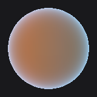 | `rim_glow` | Rim glow | classic | opaque | yes | light (1.34) | still | a soft glowing rim where the surface turns away (fresnel); calm, suits any shape, layers over any colour or material |
| 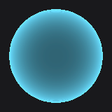 | `hologram` | Hologram | classic | add | no | light (2.26) | 0.35..2.0, 0.25 | see-through light with fine drifting scanlines, brighter edges and a faint flicker; science fiction displays and ghostly copies |
| 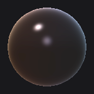 | `glass` | Glass | classic | alpha | yes | light (2.07) | still | clear in the middle, reflective at grazing angles, tinted by the material's colour; windows, bottles, vitrines |
| 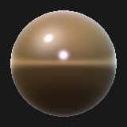 | `metal` | Metal | classic | opaque | yes | light (2.12) | still | a polished look: the room's light above, dark below, the screen's glint; the colour tints it (white chrome, gold brass, orange copper) |
| 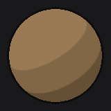 | `toon_outline` | Toon outline | classic | opaque | yes | light (1.60) | still | cel shading (three hard-edged tones of the colour) with a dark outline; cartoon and comic rooms |
|  | `dissolve` | Dissolve | classic | cutout | yes | light (1.58) | still | eaten away by noise, with a glowing edge (amount 0: whole, 1: gone); a part appearing or burning away |
| 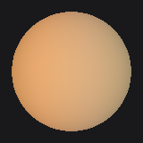 | `pulse` | Pulse | classic | opaque | yes | light (1.62) | 0.05..3.0, 0.4 | a glow that swells and fades smoothly, brightest facing you; a slow heartbeat or a breathing standby light |
| 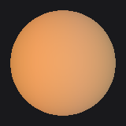 | `flicker` | Flicker | classic | opaque | yes | light (1.60) | 0.05..3.0, 0.4 | candlelight: a glow wandering on several slow waves, never a strobe; candles, lanterns, a fire's glow |
| 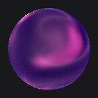 | `plasma` | Plasma | energy | opaque | no | light (1.24) | 0.0..0.4, 1.0 | slowly flowing plasma in a deep colour and a bright one, soft veins, brighter toward the silhouette; an energy core, an orb, a reactor wall |
| 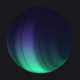 | `aurora` | Aurora | energy | opaque | no | light (1.22) | 0.0..0.4, 1.0 | soft curtains of light on a dark night, drifting sideways, fine vertical rays, green at the foot and violet above, fading top and bottom; night walls, a calm backdrop |
| 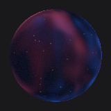 | `nebula` | Nebula | energy | opaque | no | light (1.84) | 0.0..0.4, 1.0 | deep space on the surface: glowing clouds in two colours with dark dust lanes and a few small stars, drifting very slowly; space-station windows, a night dome, a backdrop |
| 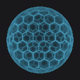 | `force_field` | Force field | energy | add | no | medium (3.64) | 0.1..1.5, 0.4 | see-through light in hexagonal cells, brighter at the edges, rows of cells brightening in a slow ripple; shields, barriers, a sci-fi dome or doorway |
| 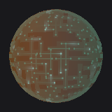 | `circuit` | Circuit | energy | opaque | yes | light (2.26) | 0.0..1.0, 0.6 | faintly glowing circuit traces with round pads over the surface, darkened to a board, small soft pulses running along them; sci-fi panels, consoles, a server room |
| 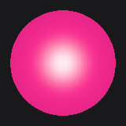 | `neon` | Neon | energy | opaque | no | light (0.50) | 0.35..1.5, 0.2 | a neon tube: a near-white core where it faces you, saturated colour toward the edges, an optional faint hum; signs, tubes, accent strips, a club or diner |
| 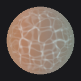 | `caustics` | Caustics | nature | opaque | yes | light (2.56) | 0.02..0.5, 1.0 | underwater light dancing over the surface in soft bright lines, two layers drifting apart; keeps the surface's colour; pool walls and floors, an aquarium room, a calm blue space |
| 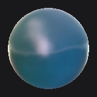 | `water` | Water | nature | opaque | no | medium (3.44) | 0.02..0.8, 0.5 | a calm rippling water surface: deep colour where you look into it, the room and the screen's glint reflected where you look across it; pools, ponds, a fountain's basin |
| 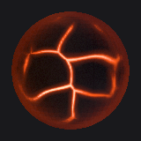 | `lava` | Lava | nature | opaque | no | light (2.41) | 0.01..0.2, 0.8 | dark cooled crust plates with glowing molten cracks between them, the heat wandering slowly along the cracks; a volcanic floor, a forge, a fire pit's bed |
| 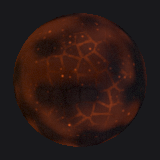 | `embers` | Embers | nature | opaque | no | light (2.60) | 0.01..1.0, 0.7 | a dark charred surface with glowing seams and scattered specks that brighten and dim slowly, each at its own pace; a hearth's bed, burnt logs, a brazier |
| 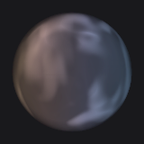 | `smoke` | Smoke | nature | alpha | no | medium (3.94) | 0.05..0.4, 1.0 | soft smoke rising and curling slowly on a see-through surface, its outline hidden; a box or sphere around a hearth, a chimney's top, a misty corner |
| 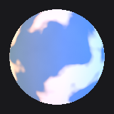 | `clouds` | Clouds | nature | opaque | no | light (1.94) | 0.01..0.3, 1.0 | soft white clouds drifting slowly over a sky colour, forming and thinning; a window, a dome, a painted ceiling |
| 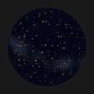 | `starfield` | Starfield | nature | opaque | no | light (0.90) | 0.15..1.0, 0.4 | tiny stars on a night colour, each twinkling gently at its own pace, with a faint band of dust; a dome, a ceiling, a panel or a globe |
| 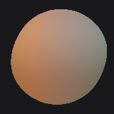 | `wind_sway` | Wind sway | nature | opaque | yes | light (0.78) | 0.03..0.6, 0.4 | the part bends from its foot in slow gusts of wind, keeping its colour; plants, grass, flags, lanterns on a cord; needs a shape with many vertices (sphere, model), not a box |
| 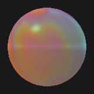 | `iridescent` | Iridescent | materials | opaque | yes | light (1.72) | still | thin-film rainbow colours over the surface's own colour, the hue turning with the angle like a soap bubble or a beetle's shell; ornaments, vases, a sci-fi trim |
| 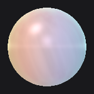 | `pearl` | Pearl | materials | opaque | no | light (2.20) | still | soft lustrous white with a faint pink and green sheen that turns with the angle and a gentle highlight; beads, a bowl, an elegant lamp or trim |
| 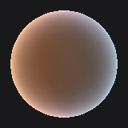 | `velvet` | Velvet | materials | opaque | yes | light (1.71) | still | the surface's colour as soft velvet: darker facing you, a bright soft sheen at the edges; sofas, cushions, curtains, a theatre's seats |
| 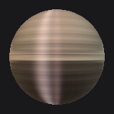 | `brushed_metal` | Brushed metal | materials | opaque | yes | medium (2.94) | still | metal with fine brushed streaks and a highlight stretched across them, tinted by the surface's colour (grey steel, gold brass); posts, panels, appliances, a modern kitchen |
| 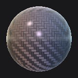 | `carbon_fibre` | Carbon fibre | materials | opaque | no | medium (3.50) | still | dark woven twill of carbon fibre under a glossy clear coat, the weave catching the light by direction; racing seats, a sports car's trim, modern furniture |
| 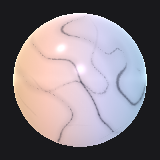 | `marble` | Marble | materials | opaque | no | medium (2.90) | 0.0..1.0, 0.75 | polished veined stone, still unless flow is set; floors, columns, a table top, a lobby or bathroom (white with grey veins, green, or black with gold) |
| 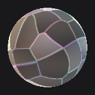 | `crystal` | Crystal | materials | alpha | no | medium (3.09) | still | see-through cut crystal: flat facets, sharp glints, faint rainbow tints along the facets' edges; gems, a chandelier's drops, an award, a magical object |
| 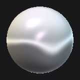 | `liquid_chrome` | Liquid chrome | materials | opaque | no | light (2.04) | 0.0..0.8, 0.75 | a mirror whose reflection slowly flows and bends as if the metal were liquid; a sci-fi sculpture, a dreamlike object, a centrepiece |
| 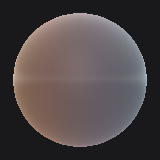 | `frosted_glass` | Frosted glass | materials | alpha | yes | light (2.35) | still | see-through milky glass, more opaque at the edges, with a soft fine grain, tinted by the surface's colour; shower screens, lamp shades, office partitions |
| 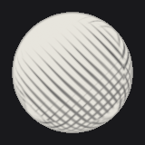 | `hatching` | Pencil hatching | stylised | opaque | yes | light (2.10) | still | a pencil drawing: strokes crossing in more layers as the shade deepens, a soft contour, on white paper or the surface's colour; sketchbook, storyboard and drawn rooms |
| 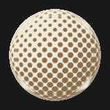 | `halftone` | Halftone | stylised | opaque | yes | light (1.63) | still | comic print: dots of the surface's colour on paper, small in the light and growing to merge in the shade; pop-art and comic-book rooms |
| 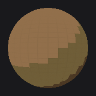 | `pixel` | Retro pixels | stylised | opaque | yes | light (1.21) | still | chunky retro pixels: the surface's colour and picture in square cells with a few hard light steps and few colours; game rooms, arcades, a low-resolution look |
| 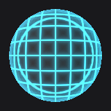 | `wireframe` | Wireframe | stylised | opaque | no | light (1.28) | still | a glowing grid traced over dark faces, as a part drawn by a computer; science fiction, blueprints, a part not yet built |
| 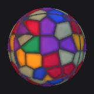 | `stained_glass` | Stained glass | stylised | opaque | no | medium (2.86) | still | panes of coloured glass in dark lead, lit from behind and brighter facing the screen; windows, lamps, a chapel or a calm jewel-toned room |
| 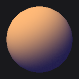 | `duotone` | Duotone | stylised | opaque | yes | light (1.17) | still | two colours only: the surface's shade and picture mapped from a shadow colour to a highlight colour; poster-like, moody, ties a room to two colours |
| 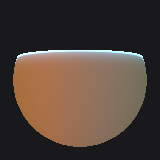 | `wipe` | Wipe | transitions | cutout | yes | light (2.44) | still | the part shown up to a plane moving along it, with a soft glowing line at the edge (amount 0: hidden, 1: whole); a part being built, revealed or scanned in |
| 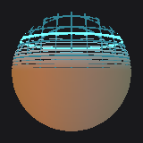 | `scan_in` | Scan in | transitions | cutout | yes | medium (2.86) | still | materialising from the bottom up: a faint grid, then glowing horizontal bands that close into the solid part behind a bright scan line (amount 0: nothing, 1: whole); arrivals, teleports |
| 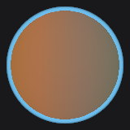 | `selection_outline` | Selection outline | transitions | opaque | yes | light (1.34) | 0.1..1.0, 0.4 | a soft glowing outline around the part, the part itself unchanged, breathing slowly or still; picks out a chosen, pointed-at or important part |
| 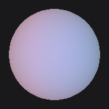 | `react_sound` | Sound glow | reactive | opaque | yes | light (1.32) | 0.5..3.0, 0.4 | a light inside that rises and settles with the film's sound, soft rings spreading from the middle when it is loud; speakers, a stage's edge, a music room |
| 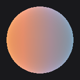 | `react_screen` | Screen sheen | reactive | opaque | yes | light (1.52) | 0.0..0.64, 1.0 | the film's own colours as a soft sheen, each side of the part taking the colour of the picture's side nearest it; ties walls and furniture to the film |
| 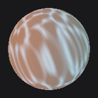 | `react_caustics` | Caustics with sound | reactive | opaque | yes | light (1.53) | 0.05..1.0, 1.0 | rippling light as under water, drifting slowly, brighter in loud passages; pools, aquariums, a calm blue room |
| 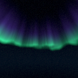 | `sky_aurora` | Aurora sky | skies | opaque | no | light (2.26) | 0.02..1.2, 0.4 | a night sky with curtains of green and violet light waving slowly above the horizon, and stars; arctic, calm, magical |
| 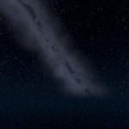 | `sky_starfield` | Starfield sky | skies | opaque | no | light (1.78) | 0.15..1.2, 0.4 | a clear night far from towns: many stars, gently twinkling, and the faint band of the galaxy with dark dust in it; quiet, vast |
| 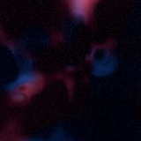 | `sky_nebula` | Nebula sky | skies | opaque | no | light (1.56) | 0.01..1.2, 0.4 | deep space all round: clouds of glowing gas in two colours with dark dust and stars, changing shape very slowly; science fiction, dreamlike |
| 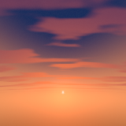 | `sky_sunset` | Sunset sky | skies | opaque | no | light (1.48) | 0.005..0.1, 1.0 | the sun on the horizon with a warm glow round it, the sky deepening overhead, thin streaks of cloud lit from below; golden hour, romantic, warm |
| 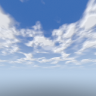 | `sky_clouds` | Cloud layers sky | skies | opaque | no | light (2.72) | 0.005..0.15, 1.0 | a day sky with two layers of cloud drifting at their own pace, the high one thin, the low one full and lit on its sunward side; open air, gardens, rooftops |

## Using an effect

An entry (`effect_info` shows one, without the shader's wiring):

| Key | Meaning |
|---|---|
| `name` | what people call it |
| `description` | one line for an assistant choosing a look: what it looks like and where it suits |
| `tags` | words to filter by (`effects tag=water`) |
| `surfaces` | `any` (parts and room surfaces) or `sky` (the sky sphere only) |
| `blend` | `opaque`, `cutout` (alpha-tested), `alpha` (see-through) or `add` (light added); the last two are drawn over what is behind (`transparent`: true) |
| `layers` | true when it keeps the surface's own colour and picture under it, so it goes over a library material |
| `passes` | 1, or 2 with a second pass (toon_outline's line) |
| `cost`, `cost_ratio`, `cost_units` | the measured tier, the measured fragment time over a plain surface's, what the room's cost cap counts |
| `animation` | `{}` when still, else `{hz: [slowest, fastest], swing}` at the fastest options |
| `options` | each with `type` (float, int, color, enum, bool), bounds, `default` and `description` |

`EffectLibrary.apply(material, id, options, seed)` sets the shader and its uniforms; the material's colour, picture,
emission and `self_lit` are set as for any surface, so an effect that layers draws over them. `validate(id, options)`
returns every problem with its path, in the room schema's words.

A few effects also dress the controllers (`scripts/xr/controller_look.gd`, `docs/features.md` "Controller look"). On
our own controller model they are compiled with `FX_PRINT` (`apply(..., {"print": true})`): the energy, nature and
materials shaders end in `fx_print()`, which draws the legends printed in that model's texture over the effect
(`shaders/controller_print.gdshaderinc`); without the define it does nothing. A new group shader that should dress the
controllers ends the same way.

## Performance

The headset renders about 1728 x 1728 a eye at 90 Hz on a mobile GPU, without MSAA, with the film playing. So:

- **Noise from textures.** Two small textures stand in for arithmetic noise: `fx_value.png` (64 x 64) gives 3D value
  noise in one tap (`fx_noise3`, `fx_noise3x2` for two at once), `fx_fbm.png` (256 x 256, mipmapped) four octaves,
  cells and cell borders in one tap (`fx_fbm2`). An effect samples them a few times; no loops of octaves.
- **One variant per effect**: the group shader compiled with the effect's define, so each pays only for itself.
- **Low frequencies.** Nothing finer than a few pixels at the distances parts are seen: there is no MSAA to smooth it.
  Detail that gets too fine fades to its average by its derivative (`fx_fine`, `fx_fine2`); drawn lines and edges are
  antialiased over a pixel with `fwidth` (`fx_line`); `fx_fbm` is mipmapped.
- **Slow motion.** Drift speeds are 0..1 options, each effect turning them into its own slow rate.
- **Transparency costs.** `alpha` and `add` effects are drawn over what is behind them (overdraw on a tiled mobile
  GPU); they cost one unit more and are flagged `transparent`.
- **Measured.** `tools/fx_lab.gd --measure` times a sphere filling a 1024 x 1024 view with each effect, against the
  plain surface (`env_unlit_tex.gdshader`, the median of it measured beside each) and the empty view: `cost_ratio`
  = (effect - empty) / (plain - empty). Tiers: light up to 2.75 (the range of the first eight, which the cost cap
  has always counted as one unit), medium up to 4.5, heavy above. Units: light 1, medium 2, heavy 3, plus 1 for a
  second pass and 1 for transparency.
- **The numbers** (2026-11-03, the software renderer, llvmpipe on 30 cores, nothing else running; the mean of two
  runs, empty 3.9 to 4.7 ms, plain 5.7 to 6.1 ms; a run to run spread of about +-0.4): 38 light (0.5 to 2.72;
  the first eight 1.34 to 2.26), 10 medium (scan_in, stained_glass 2.86; marble 2.90; brushed_metal 2.94; crystal
  3.09; water 3.44; carbon_fibre 3.50; force_field 3.64, drawn on both sides; smoke 3.94, see-through on both
  sides), none heavy. The software renderer has no tiles and no fast texture units, so it overstates texture taps
  and understates overdraw against a mobile GPU; read the ratios as an order.
- **On the headset (expected, not measured):** a plain unlit surface filling both eyes (1728 x 1728 each, with the
  fragment density map lowering the edges) costs a few tenths of a millisecond on the Frame's GPU; a light effect
  filling the view adds up to about as much again, a medium one two to three times that, so about 0.3 to 1 ms for
  a whole-view surface. Parts are seldom the whole view: a part's share of the screen scales it. `perf_calibrate`
  with the `stack` arrangement measures one on the device.

## Photosensitivity

The ceiling every effect and widget keeps (`RoomSchema.MAX_HZ`, `MAX_SWING`; the shaders' `FX_MAX_HZ`,
`FX_MAX_SWING`): no brightness change faster than 3 Hz, and no swing larger than 0.4 of the surface's own brightness.
The library states it for patterns that move as a slope: **no pixel's brightness changes faster than a 3 Hz wave of
swing 0.4 would** (2 pi x 3 x 0.4 = 7.5 times its mean brightness a second at the steepest). A pulse at 3 Hz and
0.4 is exactly at it; a pattern drifting past at full contrast may pass a pixel no faster than 1.2 times a second; a
hard edge sweeping past is never allowed. Room_react's slew limit is the same idea for the film's loudness.

- Options: a `rate` at most 3 Hz, a `swing` at most 0.4, a `speed` 0..1; the schema refuses more, naming the ceiling,
  and the shaders clamp again (`fx_rate_hz`, `fx_swing`, `fx_speed01`).
- Declared: each animated entry gives `animation.hz` (its slowest and fastest rate at a pixel) and `animation.swing`
  at the fastest options; the test checks `hz[1] <= 3` and `hz[1] x swing <= 3 x 0.4`.
- Measured: with a renderer the test renders each animated effect at its fastest options for 4 s at 30 pictures a
  second, the shader's clock stepped by hand (`FX_TEST_CLOCK`), on a dark surface (its own light is most of the
  brightness: the strictest case), and checks every pixel's steepest change against the ceiling; every still effect
  must not change at all. The first eight run on the engine's clock: their bounds are declared, and
  `test_assistant_room.gd` reads a clip of the candle.
- Flicker and twinkle are slow sines summed (`fx_wander`: at the rate and below it), never a strobe.
- Results (2026-11-03, a 64 x 64 clip for parts, 64 x 64 through 5 degrees for skies): every animated effect under
  the ceiling, the closest aurora (83 %), plasma (68 %), circuit (67 %), react_caustics (66 %), force_field (65 %);
  every still effect 0.000. A coarser clip (24 px) blurred away the steps a slow drift over a magnified noise texture
  takes (the texture filter's sub-texel steps): lava's moving crust and marble's moving noise read 170 % and more at
  64 px and above, so lava's plates are still (the heat moves along the cracks) and marble and liquid_chrome move by
  blending still taps instead. Keep a drift over sharp features out of the hardware filter's way.
- Not measured by the clip: selection_outline's breathing (its outline pass runs on the engine's clock: 1 Hz and
  0.4 at most, declared and clamped), the first eight (the engine's clock; `test_assistant_room.gd` reads the
  candle), and wind_sway's moving silhouette (motion, as `room_motion.gd`'s, not a change of brightness; its clip
  checks the gust's sheen).

## Connecting it

Connected (2026-11-03): the room document names every effect, the sky takes the sky effects, and the Objects tab's
parts editor has an Effect picker (each effect's preview, `app/textures/fx/swatches/<id>.png`, made small from the
previews by `app/tools/fx_swatches.gd`; run it again when the previews change). `docs/assistant.md` ("Effects")
says how it works in the rooms; `tests/test_room_materials.gd` checks it. Steps 1 to 7, 9 and 10 below are as
written, with these differences: a layered look is `{"library_material": "<id>", "effect": {...}}` (the room
document's key), its picture is mapped by UV on spheres and cylinders (as the library material itself) and falls back
to UV for the first eight; the `looks` listing (8) is not made (`materials` and `effects` list each). What was done:

1. **`room_schema.gd` EFFECTS, derived.** Replace the `const EFFECTS := {...}` block with

   ```gdscript
   const EffectLibrary := preload("res://scripts/effects/effect_library.gd")
   ## Material effects (docs/effects.md): {name: {description, options}}, the effect library's surface effects.
   static var EFFECTS: Dictionary = EffectLibrary.schema_effects(false)
   ```

   The first eight come out with the same names, options, bounds and defaults (`test_effects.gd` compares them), so
   every kept room still validates. `supported_effects()` and `room_state`'s `effects` then list all of them; for a
   richer listing, return `EffectLibrary.summaries("", "", "any")` there instead.
2. **`room_schema.gd` `_material`, "effect".** Check with the library, which words its errors as the schema does
   (`test_assistant_room.gd`'s "3 times a second", "no larger brightness swings" and `$.parts[2].material.effect.name`
   hold):

   ```gdscript
   "effect":
       var fx: Variant = m[k]
       var opts: Dictionary = (fx as Dictionary).duplicate() if fx is Dictionary else {}
       var fx_name := str(opts.get("name", ""))
       opts.erase("name")
       if EffectLibrary.has(fx_name) and str(EffectLibrary.entry(fx_name)["surfaces"]) == "sky":
           errors.append(_e(p + ".name", "%s is for the sky (sky.effect)" % fx_name))
       else:
           errors.append_array(EffectLibrary.validate(fx_name, opts, p).map(
                   func(x: Dictionary) -> Dictionary: return _e(x["path"], x["error"])))
   ```

3. **`room_schema.gd` `part_cost`.** The effect's units replace the fixed `effect`, `effect_second_pass` and the
   effect-named blend (they come out the same for the first eight: glass and hologram 2, toon_outline 2, the rest 1):

   ```gdscript
   var transparent_fx := fx_name != "" and str(EffectLibrary.entry(fx_name).get("blend", "")) in ["alpha", "add"]
   if not transparent_fx and (a == "blend" or (a == "" and col != null and to_color(col).a < 0.999)):
       c += COSTS["blend"]
   if fx_name != "":
       c += EffectLibrary.cost_units(fx_name) * COSTS["effect"]
   ```

4. **`assistant_room.gd` `_effect`.** Its body becomes one call (the same shader and uniforms for the first eight;
   `test_effects.gd` checks pixel for pixel), plus the film's path for a reactive effect:

   ```gdscript
   static func _effect(mat: ShaderMaterial, fx: Dictionary, key: String) -> void:
       var opts := fx.duplicate()
       opts.erase("name")
       EffectLibrary.apply(mat, str(fx["name"]), opts, EffectLibrary.seed_of(key))
       var react := str(EffectLibrary.entry(str(fx["name"])).get("react", ""))
       if react != "":
           mat.set_meta("react", react)
   ```

   `build()` already hands every material with meta `react` to the room's `RoomReact` node (loudness: react_level
   each frame; brightness: the bias light kept sampling), so react_sound, react_screen and react_caustics need nothing
   more. `material()` sets the colour, picture, emission and self_lit after `_effect`, as now: every library shader
   declares those uniforms.
5. **Part `effect` ids.** Unchanged in form: `material.effect = {"name": <id>, ...options}`, where id is any entry
   with `surfaces` "any" (`effects surface=any`). The first eight keep their ids.
6. **The sky.** `SKY_OPTIONS` / `_sky` accept `"effect": {"name": <a sky id>, ...options}`, validated with
   `EffectLibrary.validate(name, opts, "$.sky.effect")` and only `surfaces == "sky"` ids; `room_cost` adds
   `EffectLibrary.cost_units(name) * COSTS["effect"]`. In `sky_material()`, when `sky.effect` is there: a new
   ShaderMaterial, `EffectLibrary.apply(mat, name, opts, EffectLibrary.seed_of("sky"))`, on the same sphere (the sky
   shaders take `dir = VERTEX` as room_sky.gdshader does). `stars` and `clouds` stay as they are for the plain sky.
7. **Layered looks with the material library.** A material naming both, `{"material": "<library id>", "effect":
   {...}}`: if `EffectLibrary.entry(name)["layers"]` is false, the schema refuses ("draws its own surface: it does
   not layer over a material"); else the room builder takes the library material's albedo map and its tiling
   (`scripts/env/material_library.gd` on the material library's branch) and calls

   ```gdscript
   var maps: Dictionary = MaterialLibrary.textures(mat_id)
   var tint := MaterialLibrary.tint_for(mat_id, RoomSchema.to_color(m["color"])) if m.has("color") \
           else Color(MaterialLibrary.entry(mat_id).get("tint", "#ffffff"))
   var why := EffectLibrary.apply_layered(mat, name, opts, EffectLibrary.seed_of(key), {"texture": maps["albedo"],
           "color": tint, "triplanar": float(MaterialLibrary.entry(mat_id)["tiling"])})
   ```

   `triplanar` (metres a repeat) maps the picture on three axes in the part's own space, close to the material
   library's own default of each face's axes in metres; `{"uv_scale": Vector2(...)}` without `triplanar` maps it by
   the mesh's UVs instead (its `uv` option). The first eight take a picture by UV only. The normal and ORM maps are
   not used under an effect (the rooms are lit only by their fake light, and the effect owns the shading).
8. **One catalogue of looks.** For the assistant, a `looks` listing is the union: `effects` (kind effect), the
   material library's entries (kind material) and, as kind layered, any material under any effect with `layers`
   true; each with the id the room document takes.
9. **Sizes a shader can't know.** wipe and scan_in take `size` (the part's length along the axis, metres) and
   wind_sway `base` (its foot's local height) and `height`; the room builder knows each part's local bounds
   (`_aabb`) and may fill them in when the document leaves them out.
10. **Tests to update at the merge.** `test_assistant_room.gd` checks `room_state`'s `effects` has 8 entries; make it
   `EffectLibrary.schema_effects(false).size()`.

## Adding an effect

1. Pick its group (or start one: `catalogue/<group>.gd` with `SHADER` and `EFFECTS`, and add the file to
   `EffectLibrary.GROUPS`).
2. Write its block in the group shader: `#elif defined(FX_<NAME>)`, starting from `FxSurface s` (`s.lit` is the
   surface without the effect, `s.base` its colour, `s.light` the room's light, `s.n`, `s.v`, `s.facing`). Use
   `FX_TIME` for the clock (never `TIME`), the noise helpers, `fx_swing` for any brightness wave. A transparent effect
   adds its `render_mode` line under `#if defined(FX_<NAME>)` at the top and sets `ALPHA`.
3. Add its entry: name, a one-line description that says what it looks like and where it suits, tags, surfaces,
   blend, layers, the options with `uniform` (fx_color, fx_color2, fx_strength, fx_speed, fx_scale, fx_rate,
   fx_depth, fx_amount, fx_param, fx_mode, or the effect's own), and `animation` worked out from its fastest rates.
4. Run `tools/fx_lab.gd --measure --ids=<id>` and put its `cost_ratio` and tier in; `--previews=$PWD/docs/shots/effects`
   for the previews (all of them, so the sheet stays whole); `--photo --ids=<id>` to see its margin under the
   ceiling.
5. Run `tests/test_effects.gd` with a renderer.
