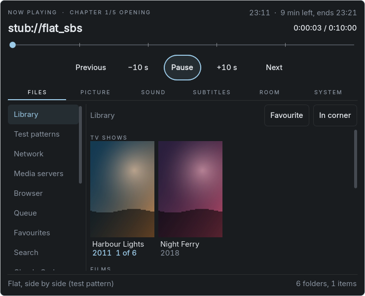
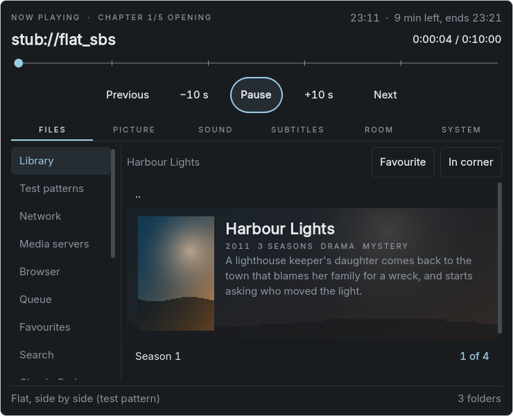
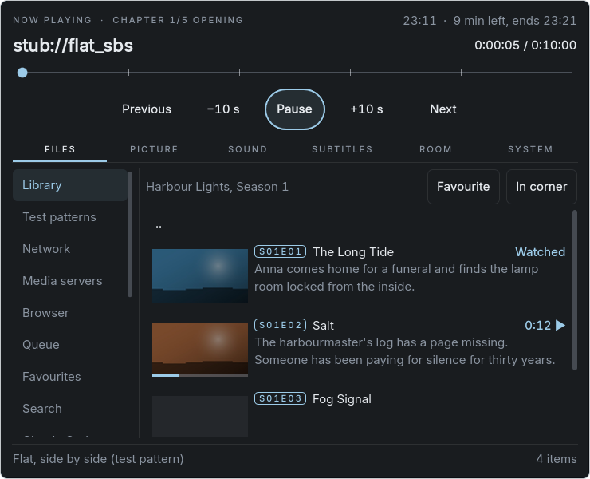

# The Library

A local shelf on the headset: the folder `~/Videos/Library`, shown in Files as posters, seasons and episodes. It is a
view of that folder, not a database. Nothing is scanned in the background, and network shares are never scanned at all:
a file gets there because someone copied it. Agents and assistants fill it (`app/assistant/library.md` tells them how).
The app itself scrapes nothing and fetches nothing from the web. Decision D19 records why this replaced "no library" in
D11.







These are the real panel at its own 740 x 600 pixels, drawn from the generated library in
`app/tests/library_fixture.gd`.

## Layout

The one Kodi and Jellyfin expect, relative to `~/Videos/Library`:

```
TV Shows/<Show> (<Year>)/tvshow.nfo
TV Shows/<Show> (<Year>)/poster.jpg
TV Shows/<Show> (<Year>)/fanart.jpg
TV Shows/<Show> (<Year>)/Season 01/<Show> - S01E01 - <Title>.<ext>
TV Shows/<Show> (<Year>)/Season 01/<Show> - S01E01 - <Title>.nfo
TV Shows/<Show> (<Year>)/Season 01/<Show> - S01E01 - <Title>-thumb.jpg
Movies/<Title> (<Year>)/<Title> (<Year>).<ext>
Movies/<Title> (<Year>)/<Title> (<Year>).nfo
Movies/<Title> (<Year>)/poster.jpg
Movies/<Title> (<Year>)/fanart.jpg
```

The place is always listed in Files, and opening it makes the folders. A folder with no NFO shows as a plain folder and
lists like any other.

## What shows

| Folder | View |
|---|---|
| `Library` | Shows and films as a grid of posters, then plain folders |
| `TV Shows`, `Movies` | That half of the grid |
| A show | Its fanart, poster, year, genres and plot; a row per season, with how much was watched |
| A season | A row per episode: thumbnail, S01E01, title, short plot, watched or how far |
| A film | Its fanart, poster, year, length, genres and plot; Play |

Watched comes from the resume data (`user://resume.cfg`): "Watched", the position with a thin bar, or for a show or
season "2 of 6". The resume data keeps its 500 newest files, so very old ones lose the mark. `<playcount>` and `<watched>`
in an NFO are not read.

Opening an episode or film from the Library, by any route, shows the NFO's title on the overlay and in `/state`:
"Show S01E02: Title", "Title (2019)". `/state` also has `library`, with what the NFO says. Without an NFO the name of the
file gives the numbers and title. Next and previous follow the season by episode number. Posters and thumbnails sit
beside the videos, so the playlist of a Library file takes videos only.

## NFO files

`scripts/library/library_nfo.gd` reads Kodi's XML with the engine's `XMLParser`. The fields are those of Kodi's own
parser (`xbmc/video/VideoInfoTag.cpp`, master): the Kodi wiki refused every request when this was written, so the
fields were not checked against it. Read: `title`, `showtitle`, `originaltitle`, `sorttitle`, `plot`, `outline`,
`tagline`, `premiered`, `aired`, `year`, `runtime` (minutes), `season`, `episode`, `displayseason`, `displayepisode`,
`mpaa`, `genre`, `studio`, `namedseason`. Year as in Kodi: `premiered` first, then `year`.

Everything is optional. A broken file gives what was read before it broke. Several `episodedetails` in one file are one
file with several episodes. A URL line after the XML is ignored. Nothing in a file is followed or run: `thumb` and `fanart`
URLs are not read, nested elements are skipped, entities are not expanded, and files over 1 MiB are not read.

## Keeping it light

- A view is read on a worker thread, like any folder listing. Drawing it on the main thread took 2 to 3 ms for the poster
  wall (lavapipe, on a PC), and the worst frame while it opened matched the worst frame with nothing happening.
- Pictures (`scripts/library/library_images.gd`) are decoded on one low-priority worker, cropped and scaled to the size they
  are shown at, and kept as small JPEGs in `user://library_cache/`. They reach the GPU one per frame, and 120 stay in
  memory. A picture over 32 MiB is not decoded. Marks update in place from the resume data, with no file read.

## Filling it

`copy_to_library {from, to}` (control level) copies a file from a saved SMB host into the Library, on a worker, with
`download`-style events (`library_copy`), a card with Cancel, a `.part` file, and 2 GB of the disk kept free. There is no
SMB mount on the headset and no smbclient, and an agent must never see the login, so the app reads the file with the login
it holds. `to` must be a plain path under `TV Shows/` or `Movies/`, and a video, an NFO, a picture or subtitles.

`fetch` takes `to` as well, for what an assistant serves from its own machine. `list_dir` with `all=true` lists every
file of a folder, so an NFO or picture already on a share can be found and copied.

Copying needs the engine's `MediaBrowser.open_read`, `read_next` and `close_read` (fork branch `frame/library-copy`,
`docs/BUILD.md`). An older engine has only `read_file`, so files up to 64 MiB copy and a bigger one fails saying why.

An agent on the headset gets the short version in `CLAUDE.md` and `AGENTS.md`: what "import" and "info files" mean, where
things go, and that shares go only through the player. It loads in every session, so the details are in the guide. The app
owns a marked block in those files and rewrites it when its text changes; anything outside it stays. A file written before
there was a block loses the app's own lines, and any line the user added or changed stays.

## Tests

```
godot --headless --xr-mode off --path app --script res://tests/test_library.gd
ROOM_SNAPSHOT_OUT=dir godot --display-driver x11 --rendering-driver vulkan --xr-mode off --path app --script res://tests/test_library_view.gd
```

`test_library.gd` (115 checks): NFOs (entities, CDATA, nested elements, several episodes, a cut file, rubbish, an external
entity, a byte order mark, UTF-16, an oversized file); the views; episode order; titles on the overlay and in `/state`; next
and previous; watched marks; the picture cache, rubbish pictures, one texture a frame; finding a file on a share through
`list_dir`; `copy_to_library` with its refusals, a failed read, the disk, cancel, one at a time; the engine's read in
pieces on a 70 MiB local file; the guide. `test_library_view.gd`: the four views fit the panel, the cost of building the
wall, and the pictures. `test_local_agents.gd` covers the marked block.

## Not done yet

- Not run on the headset.
- `open_read` has not been run against a real SMB server: it uses the `SmbFile` class that plays videos from shares, but
  only local files went through the new calls here. The first copy from a share on the headset is its first real test.
- `get_iplayer`'s options are described from its source (`--pid-recursive-list`, `--metadata`, `--metadata-only`,
  `--thumb`, `--thumbnail-only`), not from a run.
- An agent writing into the folder directly shows when the place is next opened; a finished `copy_to_library` refreshes
  the view at once.
